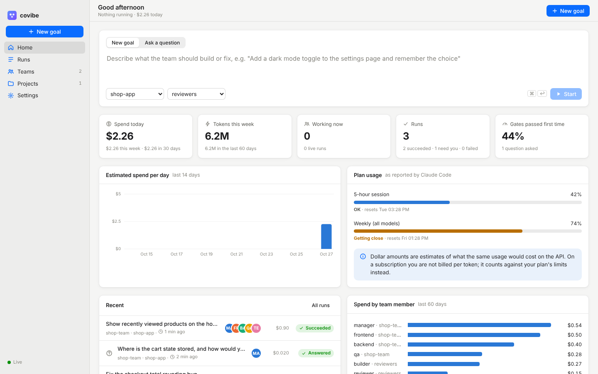
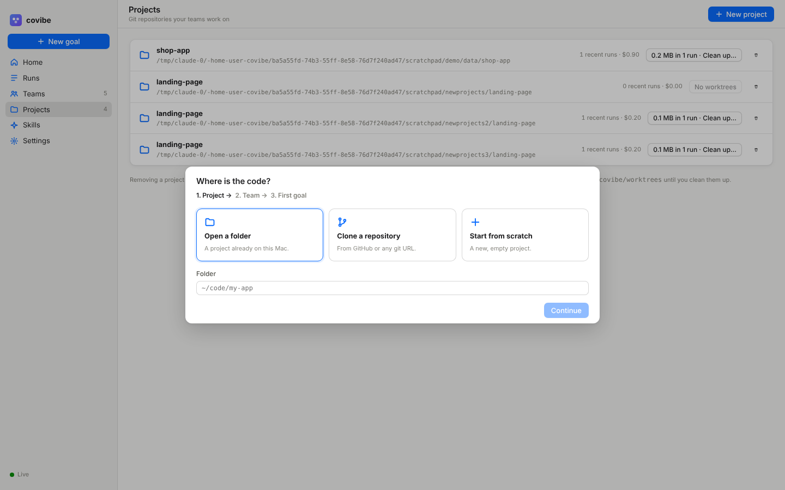
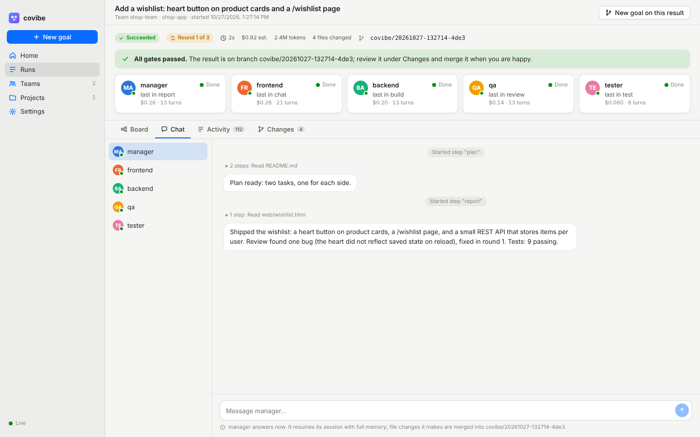
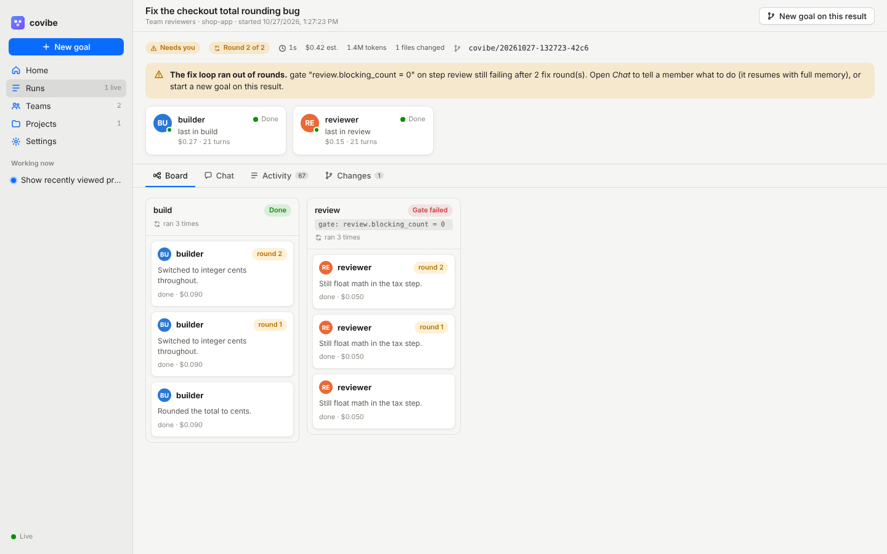
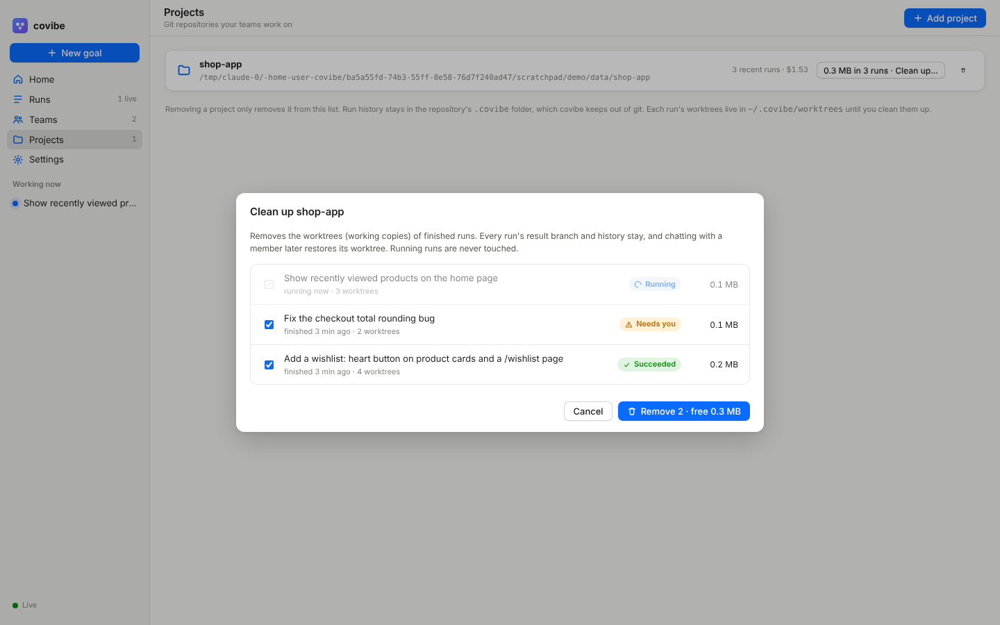
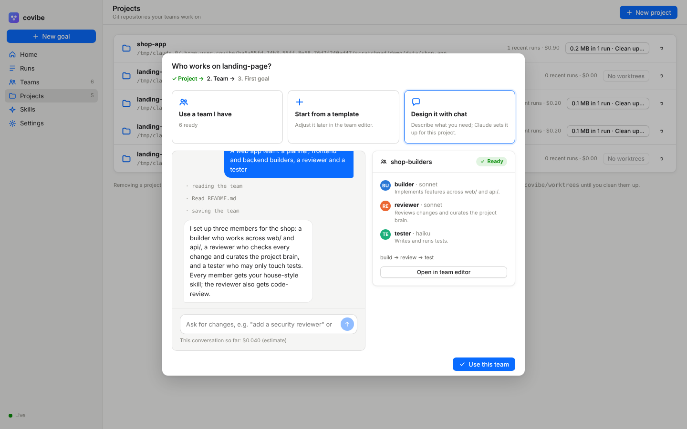
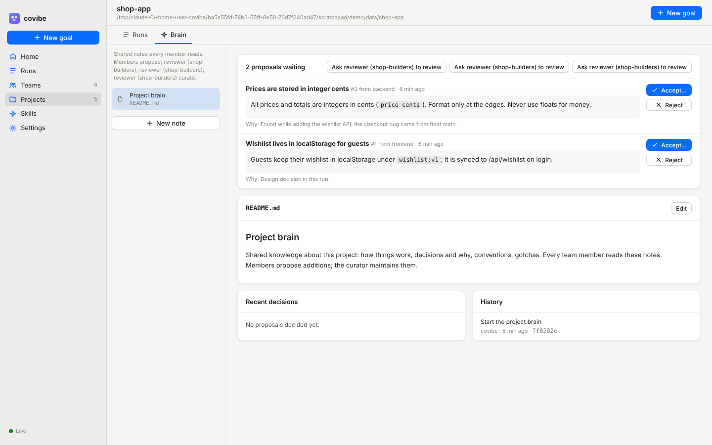
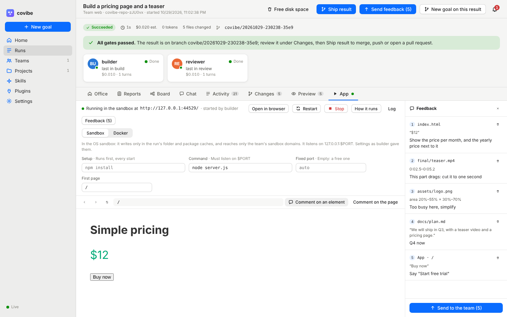
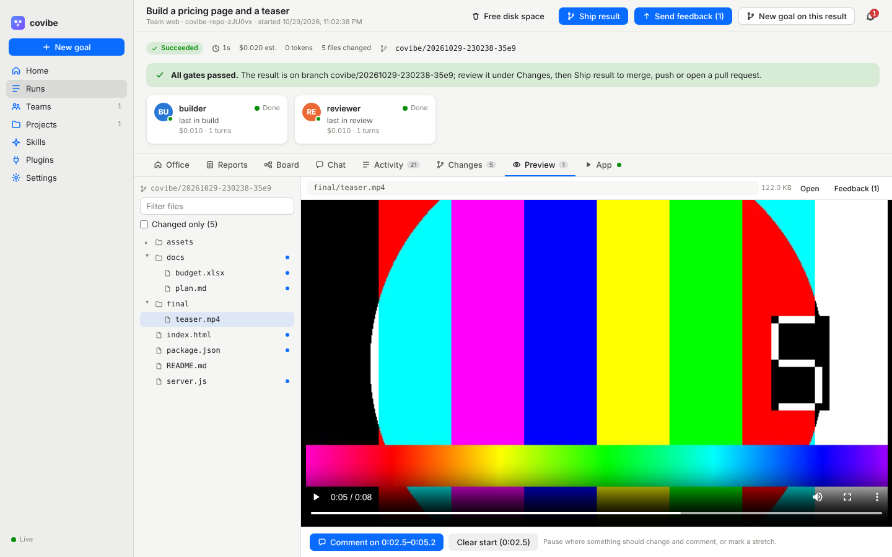

# covibe

A thin multi-agent studio on top of the [Claude Agent SDK](https://docs.claude.com/en/api/agent-sdk/overview).
You define a team (manager, frontend, backend, QA, tester, or any roles you like) in one YAML file. covibe runs it
with role-scoped write permissions, hard gates, and a bounded fix loop. Every agent action goes into one JSON
event log. Teams work on code in git repositories, and on anything else in [plain folders](#plain-folders):
documents, video footage, research.

The engine, not a model, decides control flow: which step runs next, whether a gate passed, when to loop back, and
when to stop and hand the run to you. Models only do the work and return structured reports.

There are two ways to use it: the **Mac app** (dashboard, team editor, live board, chat) and the **`covibe` CLI**.
Both run the same engine on the same files, so a run started in the terminal shows up live in the app.



## The Mac app

### Install

Requirements: macOS, Node ≥ 22.13, git, and Claude Code signed in (`claude login`) or another
[backend](#backends).

```sh
npm install          # also builds the engine and the UI
npm run desktop      # opens covibe in a window
npm run dist:mac     # builds a .dmg and a .zip in release/
```

You can also skip local builds: run the **desktop** workflow from the repository's Actions tab, which builds
`.dmg` files for Apple silicon and Intel and attaches them to the run.

The app is not code-signed. The first time, right-click covibe in Applications and choose **Open**, or run
`xattr -dr com.apple.quarantine /Applications/covibe.app`.

To try the UI in a browser instead, run `covibe app`.

### Getting started in the app

**New project** walks you through three steps:

1. **Where is the work?** Open a folder on your Mac, clone a repository (GitHub or any git URL), or start from
   scratch. A folder without git can be used as it is, as a [plain folder](#plain-folders) (documents, footage,
   research), or set up for you as a repository: covibe runs `git init` and makes a first commit, leaving out
   `node_modules`, `.env` files and build folders.
2. **Who works on it?** Use a team you have, start from a template, or **design it with chat**.
3. **What should they do first?** Give the first goal and watch the team start.



### What you can do

| Screen | What it shows and does |
|---|---|
| **Home** | Today's and this week's estimated spend, tokens, members working now, run outcomes, gate pass rate; your plan's 5-hour and weekly usage as Claude Code reports it, with reset countdowns (also at the bottom of the sidebar); spend per day and per team member; live runs and recent ones. Give a new goal or ask a question right there (⌘N anywhere). |
| **Run** | Every member with its status (working, done, has messages, stopped), what it is doing right now, and its cost. Tabs: **Office** (the team as a pixel office: a desk and name plate per member; they sleep when idle, type when working, raise a hand when they ask the lead or you, and wait with hands off the keyboard while the run is paused; a member driving a browser gets a browser button above its desk that opens its browser live, or what it saw (see [Preview and live browser](#preview-and-live-browser)); click a desk for the member's details, chat and activity), **Plan** (the manager's plan, readable: its summary and every task by owner with what "done" means and how far that member is; below it, the requests members made of each other and every other step's latest report, such as the review's findings; called **Reports** when the team has no planning step), **Board** (a column per workflow step, a card per member and fix round, gate results; a card on a teammate's request says whose), **Chat** (one thread per member), **Activity** (the full timeline, with problems pinned on top), **Changes** (the diff of the result branch), **Preview** (the result's files: web pages open as a site you can click through, videos and audio play, images and PDFs show, Markdown is rendered, office files open in Word, Excel or PowerPoint, everything else shows as text; see [Feedback on the result](#feedback-on-the-result)), **App** (the project's app running in the sandbox or in Docker, to use live; see [Running the app](#running-the-app)). Stop a run, start a **new goal on this result**, or **send feedback**: comments you pinned on a moment of a video, an area of an image, a passage or an element of a page or the app, sent as a new goal. When a run succeeds, covibe asks what to do with its result: **merge** it into your branch (and push), **open a pull request**, or just **push** the branch (**Ship result** brings that back later). |
| **Files** | Give the team images and documents with a goal, a question or a chat message: the paperclip, drop them on the box, or paste a screenshot (see [Files for the team](#files-for-the-team)). |
| **Voice input** | A mic button next to the goal box and every chat: talk, and the text appears in the box. It runs on your Mac with whisper.cpp, or uses OpenAI or ElevenLabs (see [Voice input](#voice-input)). |
| **Chat** | While a member is working, choose **Now** (it reads your message between tool calls and adjusts), **Stop and redirect** (it ends its current turn and answers you first) or **Next turn**. After the run, the member resumes its session and answers right away; anything it changes is scope-checked and merged into the run's branch. |
| **Ask a question** | A read-only session with one member in your project: it can read the code but not change it. Follow-up questions continue the same session. |
| **Teams** | Create a team from a template (feature team, builder + reviewer, single assistant, writing, video editing, research) and edit it: **Members** (role prompt, model, tools, which paths it may change, who it can message, who it can ask for work, report format, connection, limits), **Workflow** (a drag-and-drop graph: drag steps to reorder, drag members onto a step or between steps, drag a gate's ↺ handle onto an earlier step to set where failed work goes back; plus forms for gates and the fix loop), **Team settings** (connection, sandbox, limits), **YAML** (checked as you type), **Files** (prompts and report schemas). Form edits keep the comments and formatting of `team.yaml`. |
| **Team chat** | Describe the team you need and an architect agent sets it up: it reads your project to fit the stack and folders, asks only if something important is unclear, and saves the team through a tool that refuses invalid files and hands the problems back to it. Keep talking to change it ("add a security reviewer", "use haiku for the tester"). Available in New project, New team, and every team's **Chat** tab. |
| **Skills** | One library of skills for all teams: **write your own**, **add from GitHub** (a repository or a folder; private ones work if git can clone them), or install from **Anthropic's skills**. Claude Code's **built-in skills** are listed too. Give skills to a member, to every member of a team, or mark one **Everyone** to give it to all members of all teams. |
| **Plugins** | Claude Code plugins (skills, slash commands, agents, hooks, MCP and LSP servers) from **Anthropic's directory** or **any GitHub repository or marketplace**, or **any MCP server** (ElevenLabs, Linear, your own) from its address, command or JSON snippet (see [Adding any MCP server](#adding-any-mcp-server)). Before installing, covibe shows what a plugin runs on your computer and where it sends data, and you choose its sandbox: the websites it may reach and the folders it may write. Every hook and server it runs is confined to that sandbox. Keys its servers need are saved on its page, with covibe's other keys. Give plugins to members like skills. |
| **Projects** | Each project has **Runs**, **Backlog**, **Brain** and **Git** tabs. **Backlog** lines goals up: each is checked for anything only you can settle, then the team works them off one after another (see [Backlog](#backlog)). **Git** works with your checkout (see [The Git tab](#the-git-tab)): fetch, pull, push, stage and commit, stashes, branches local and on the remote, merges and rebases with conflicts resolved file by file, a commit graph to revert, cherry-pick, branch, tag or reset from, remotes, any git command, and a **git helper** to chat with when something is stuck. The project list shows the disk space run worktrees use, with a **Clean up** dialog; a finished run has **Free disk space**, and Settings can remove worktrees automatically after a number of days. |
| **Settings → Advanced** | Sign in more **Claude accounts** (each in its own Claude Code folder), turn on **sharing work across them**, sign in **ChatGPT accounts** (the sign-in Codex uses) to put members on OpenAI's models within your ChatGPT plan, and add **model providers** with an API key (DeepSeek, Moonshot, Z.ai, OpenAI, OpenRouter, Groq, a local Ollama, or any Anthropic- or OpenAI-compatible API). Their models then appear in every team's model list. See [Accounts and providers](#accounts-and-providers). |
| **Brain** | The project's shared notes. Every member reads them before working and can **propose** additions; only the team's **curator** (or you) writes. Review proposals yourself (accept into a new or existing note, or reject) or ask the curator. Edit notes directly; every change is in the brain's own git history. |


| | |
|---|---|
|  |  |
|  |  |

The app follows the system's light or dark appearance.

| | |
|---|---|
|  |  |
|  |  |
|  |  |
|  | |

**About the numbers.** Dollar amounts are Claude Code's estimate of what the usage would cost on the API. On a
subscription you are not billed per token; usage counts against your plan's 5-hour and weekly limits, which the
Home screen shows once a team has run.

**How it fits together.** The app starts the covibe server inside itself, on `127.0.0.1` with a random port and a
per-launch access token, and shows the UI in a native window with a translucent sidebar. Teams and settings live
in `~/.covibe/` (override with `COVIBE_HOME`), run worktrees in `~/.covibe/worktrees/`, and each project's run
history in `<repo>/.covibe/covibe.db`. Quitting while runs are working asks first, because quitting stops them.

## Quick start (CLI)

Requirements: Node ≥ 22.13, git, and Claude Code credentials. For your own machine, `claude login` with your
subscription is enough (see [Backends](#backends)).

```sh
npm install
npm run build
npm link            # optional: puts `covibe` on your PATH

covibe validate examples/feature-team/team.yaml
cd ~/code/my-app    # a git repository with at least one commit
covibe run ~/covibe/examples/feature-team/team.yaml --goal "Add a /health endpoint and show its status in the footer"
```

Each event prints as one line while the run goes:

```
12:46:46 run                run started: feature-team — Add a /health endpoint … [worktree, branch covibe/20261027-124646-37d6]
12:46:46 plan/manager       started opus via subscription
12:47:03 build/frontend     blocked Write api/health.ts: api/health.ts is outside your write scope (web/**). Report the change …
12:47:20 build/backend      committed f1331369 (2 files)
12:47:20 build/backend      merged into covibe/20261027-124646-37d6
12:47:41 review             gate failed: review.blocking_count = 0 → false
12:47:41 review             ↺ back to build (round 1/3) feedback: {"review.findings":[…]}
…
12:49:12 run                run succeeded (loops 1, $0.4210)
```

Your checkout is never touched. The result lands on the branch `covibe/<run-id>`. Review it with
`git diff HEAD...covibe/<run-id>` and merge it when you are happy with it.

### Commands

| Command | What it does |
|---|---|
| `covibe validate [team.yaml]` | Strict YAML parse, JSON Schema validation and cross-reference checks |
| `covibe run [team.yaml] --goal "…" [--attach <file>…]` | Run the workflow, with files for the members. Exit code 0 = succeeded, 2 = escalated to you, 1 = failed |
| `covibe runs` | List recent runs in this repository |
| `covibe log <run> [--follow] [--json]` | Print a run's event log. `--json` prints the raw events, one per line |
| `covibe chat <run> <agent> <message…> [--now \| --interrupt] [--attach <file>…]` | Talk to an agent (see [Chat](#chat)) |
| `covibe answer <run> [<question> <answer…>]` | Answer a member's question; without a question id, list the ones waiting for you (see [Questions](#questions)) |
| `covibe changes <run>` | List what a run in a [plain folder](#plain-folders) changed, and who changed it |
| `covibe undo <run>` | Put a plain folder back the way it was before a run |
| `covibe clean [--older-than <days>] [--run <id>] [--dry-run]` | Remove worktrees of finished runs (in a plain folder: the copies kept for undo); branches and history stay |
| `covibe app [--port <n>] [--no-open]` | Serve the app UI in your browser |
| `covibe connections` | List the Claude accounts, ChatGPT accounts and providers set up in Settings → Advanced |
| `covibe login <account>` | Sign one of those accounts in: a Claude account runs `claude auth login` in its own config folder; a ChatGPT account opens OpenAI's sign-in in your browser |
| `covibe login <plugin>` | Sign in to a plugin's remote servers (Notion, say) in your browser, for your members (see [Signing in to plugin servers](#signing-in-to-plugin-servers)) |

Run ids accept a unique prefix. The event store lives in `<repo>/.covibe/covibe.db`; covibe writes its own
`.gitignore` there. Worktrees live outside the repository, in `~/.covibe/worktrees/`.

## The team file

```yaml
version: 1
name: feature-team
lead: manager                       # answers members' questions first (default: a member named manager; null = nobody)

defaults:
  backend: { type: subscription }   # subscription | connection | api_key | gateway | bedrock | vertex
  isolation: worktree               # one git worktree per writing agent (or: none)
  max_parallel: 2                   # cap on concurrently running agents
  limits: { max_turns: 40, timeout_min: 30 }   # optional: max_budget_usd

agents:
  manager:
    prompt: prompts/manager.md      # Markdown file, relative to the team file
    model: opus                     # an alias (opus | sonnet | haiku) or a model id
    effort: high                    # low | medium | high | xhigh | max (also under defaults)
    thinking: adaptive              # adaptive | off | a token budget such as 8000 (older models)
    cache_ttl: 1h                   # 5m | 1h: how long Claude keeps its prompt cache (also under defaults)
    tools: [Read, Grep, Glob]       # no edit tools: plans, cannot change code
  frontend:
    prompt: prompts/frontend.md
    tools: &builder [Read, Edit, Write, Bash, Grep, Glob]
    scope: { write: ["web/**"] }    # enforced, see below
    can_message: [backend]          # gets a send_message tool for these teammates
    can_request: [designer]         # may ask the designer for work (request_work), if and when it wants
    output_schema: schemas/build.json
  designer:                         # in no workflow step: works only when someone asks
    prompt: prompts/designer.md
    tools: [Read, Write, Edit, Grep, Glob]
    scope: { write: ["design/**"] }
  qa:
    prompt: prompts/qa.md
    tools: [Read, Grep, Glob]
    browser: true                   # covibe's browser: open, click through and screenshot pages (also under defaults)
    output_schema: schemas/review.json
  # …

workflow:
  on_gate_fail:                     # default for every gated step; a step may override it
    goto: build
    max_loops: 3
    feed: [review.findings, test.failures]
    then: escalate_to_human         # or: fail
  steps:
    - id: plan
      agent: manager
      output_schema: schemas/plan.json
    - id: build
      parallel:
        - { agent: frontend, task: "plan.tasks[owner = 'frontend']" }
        - { agent: backend,  task: "plan.tasks[owner = 'backend']" }
    - id: review
      agent: qa
      gate: "review.blocking_count = 0"
    - id: test
      agent: tester
      gate: "test.failed = 0 and test.passed > 0"
```

See [`examples/feature-team/`](examples/feature-team) for the full file, its prompts and its report schemas. Put
`# yaml-language-server: $schema=<path>/schemas/team.schema.json` at the top of a team file to get autocomplete
and inline errors in editors.

### Skills and the brain in the team file

```yaml
defaults:
  skills: [house-style]          # every member of this team
brain:
  curator: reviewer              # maintains the project brain; needs Write or Edit
  curate: after_run              # or: manual (only when you ask)
  min_proposals: 5               # after_run: wait until this many proposals are waiting (default 1)
agents:
  reviewer:
    skills: [code-review, pdf]   # library skills by name, or Claude Code built-ins
    plugins: [hookify, aikido]   # from your plugin library (team defaults work the same way)
```

**Skills.** Library skills live in `~/.covibe/skills-plugin/skills/<name>/SKILL.md` (with any files they use),
packaged as a local Claude Code plugin. Each member gets exactly its skills (team defaults, its own, and
library skills marked Everyone) through the SDK's `skills` filter, so other installed skills stay hidden from
it. Skills installed from GitHub remember where they came from and can be updated. Files a repository keeps in Git LFS
(videos, audio) are downloaded when git-lfs can and they come to at most 50 MB for what you install; otherwise they
stay small pointer files, and a failing LFS download never stops the install. The same goes for plugins.

**Plugins.** A Claude Code plugin can run programs on your computer: hooks (shell commands on events such as
every tool call), MCP and LSP servers, and monitors. Claude Code runs those with your full permissions, outside
its shell sandbox. covibe does not let it: it keeps the plugin's own hook, server and monitor configuration to
itself and gives Claude Code a copy of the plugin in which each of them starts through covibe's launcher
(`src/plugin-sandbox.ts`). The launcher looks the real command up in a file the plugin cannot write and runs it
in the OS sandbox ([Anthropic's sandbox runtime](https://github.com/anthropics/sandbox-runtime): Seatbelt on
macOS, bubblewrap on Linux) with that plugin's policy:

| | A plugin's programs |
|---|---|
| Read | Everything outside your home folder. In it, only the plugin, its data folder, language toolchains (`~/.nvm`, `~/.cargo`…) and the member's working folder: not `~/.ssh`, `~/.aws`, your other projects or Claude's settings |
| Write | Their own data folder (`CLAUDE_PLUGIN_DATA`, which holds their `TMPDIR`) and folders you allow; the working folder only if you allow it, and never its `.git`, `.claude` or `.mcp.json` (what is there would run outside the sandbox) |
| Network | Only the domains you allow (none by default; an `npx` or `uvx` server is offered its package registry) |
| Environment | `PATH`, `HOME`, locale and the plugin's own folders, plus the variables a server declares in its config (filled in from the keys saved for that plugin, then your environment). Your other API keys and tokens stay out |

What a plugin sends to a remote MCP server or an HTTP hook leaves your computer, so the review lists those
addresses separately. Settings a plugin would apply to Claude Code (`settings.json`) are left out. Installing
records what the plugin runs; an update that changes it (a new hook, a different server command) stops the plugin
from being given to members until you approve it on its page. If a member has a plugin that runs programs and
the sandbox cannot start (on Linux it needs `bubblewrap`, `socat` and `ripgrep`), the run fails before it
starts: a plugin never runs unconfined. Plugins live in `~/.covibe/plugins/<name>/`, their data in
`~/.covibe/plugin-data/<name>/`.

**The brain.** Each project's brain is a folder of Markdown notes in `~/.covibe/brains/<repo>-<hash>/`,
outside the repository, and its own git repository (so every change has an author and history). Every member
can read it (it is added as a readable folder) and its system prompt lists the notes. Members other than the
curator get a `propose_brain_note` tool; their file tools are blocked from the brain, and the shell sandbox
cannot write there. The curator may edit the brain directly. With `curate: after_run`, the curator reviews
pending proposals at the end of a run, merging accepted ones into notes and recording a decision for each.
Each review is a session of its own, so `min_proposals` lets proposals collect over several runs first.

### Signing in to plugin servers

Some plugins connect to a remote MCP server that needs your account, such as Notion's. Their page under
**Plugins** has a **Sign-in** card with a **Sign in** button per server (on the command line: `covibe login
<plugin>`). Your browser opens the service's own sign-in page; covibe registers itself as an OAuth client (with
PKCE) and keeps the tokens with its other keys (the macOS Keychain, or `~/.covibe/secrets.json`).

Members never get the tokens. Their Claude Code reaches a signed-in server through a proxy inside covibe, on
127.0.0.1 with a random key in its address; the proxy adds the token, renews it when it runs out or the server
refuses it, and passes everything else through as it is. If renewing fails, the card says so and asks you to sign
in again. Signing out (or deleting the plugin) forgets the tokens, and members go back to the server's own
address. covibe signs in to servers on https (or on this computer) that use MCP's streamable HTTP transport.

covibe normally registers itself with the server's sign-in service. Services that do not allow that but accept a
*client metadata document* (ElevenLabs, for example) are signed in to with covibe's instead: its address is
covibe's client id, the service reads covibe's name and callback (`http://127.0.0.1:47815/callback`) from it, and
nothing needs setting up. The document is [`docs/oauth/client-metadata.json`](docs/oauth/client-metadata.json),
fetched from this repository on GitHub; to publish a copy elsewhere, set `COVIBE_CLIENT_METADATA_URL` to its https
address and make its `client_id` that same address.

Other services allow neither and say so when you click **Sign in** (GitHub and Slack, for example). For those, create an OAuth app in the service's
developer settings with the callback address `http://127.0.0.1:47815/callback`, then enter its client id (and
secret, if it has one) under **Use your own OAuth app** on the plugin's page. The id is kept in
`~/.covibe/mcp-clients.json` and the secret with your keys.

### Adding any MCP server

**Plugins → Add MCP server** takes whatever the service publishes for Claude Code, Claude Desktop, Cursor or VS Code:

- an address: `https://mcp.example.com/mcp` (add an API key header there if the server takes a key instead of a sign-in)
- a command: `npx -y @example/mcp-server`, or `EXAMPLE_API_KEY=… uvx example-mcp`
- a JSON snippet: `{ "mcpServers": { "elevenlabs": { "command": "uvx", "args": ["elevenlabs-mcp"], "env": { "ELEVENLABS_API_KEY": "…" } } } }`
  (also VS Code's `"servers"`, a single server, or a snippet copied without its outer braces)

covibe turns it into a small plugin of your own (shown as **MCP server you added**) and gives it the same review,
sandbox, sign-in and proxy as any plugin. Give it to members by its name (`plugins: [elevenlabs]`). **Change
servers** on its page edits the config later. A server started on this computer can only reach the websites
you allow, so add the address of the service it talks to (for ElevenLabs, `api.elevenlabs.io`).

**Keys.** Keys written into what you paste (an `env` value or a header such as `Authorization` or `x-api-key`)
are taken out: the config gets `${VARIABLE}` instead, and the value is saved with covibe's other keys (the
Keychain, or `~/.covibe/secrets.json`). Placeholders such as `<your-api-key>` become variables to fill in. Every
plugin's page, including plugins from GitHub, has a **Keys and settings** card listing the variables its servers
use (`${VAR}` in its config, or an `env` entry with no value), saved or not.

Members never get these values, in their environment or in a file they can read. The sandbox launcher reads
them when it starts one of the plugin's servers and gives them to that server alone. A remote server that needs
a key in its address or headers is reached through covibe's MCP proxy, which adds the key, like a sign-in token.
A variable you have not saved is taken from the environment covibe runs in, as before.

### How the pieces fit

- **Step outputs.** Each step's output goes into the run context under its id. With an `output_schema`, the output
  is the agent's structured report, validated against the schema; a report that does not match fails the step.
  Without one, it is `{ "text": "…" }`. A parallel step's output is `{ "<agent>": <report>, … }`.
- **Expressions.** `task`, `gate` and `feed` are [JSONata](https://jsonata.org) expressions, evaluated by the
  engine against the context: step outputs, plus `goal`, `loop` (the current fix round) and `feedback`. A gate
  passes only when it evaluates to literal `true`. A missing field or a number counts as failing.
- **Tasks.** If a branch's `task` selects nothing (`undefined` or `[]`), that branch is skipped.
- **Summary steps.** `{ id: report, summary: true }` is the run's summary, with no member. covibe gathers it from the
  log (plan, tasks, each member's latest report, files changed, gates, fix rounds, questions answered, open minor
  findings). Without a model that is the summary, and it costs nothing. With `model` (and optionally `effort`, a
  `backend` for another provider, and `instructions` on how to write it), that model writes the facts up in one
  request: no tools, no member's session, no git status or `CLAUDE.md`. If it fails, covibe's own summary is used.
  Its output is `{ "text": "…" }`, shown in the Plan tab. In the app: **Workflow**, the step, **Summary**, **Model**.

  ```yaml
  - { id: report, summary: true }                                  # covibe writes it, no model
  - { id: report, summary: true, model: haiku, effort: low,        # Haiku writes it up
      instructions: "Release notes for the team, in German." }
  ```
- **Who is needed.** The planner (the member of a step named `plan`, or the lead's first step) names the members the
  goal needs, with the `select_members` tool or a `members` list in its plan report. Steps of members it leaves out
  and gives no task are skipped, gates included. `required: true` on a step keeps it running in full. If the planner
  does not choose, every step runs.
- **Loops.** When a gate fails, the engine evaluates the `feed` expressions, stores them as `feedback`, and jumps
  back to `goto`. The agents there get the feedback in their prompt and resume their own sessions, so they
  remember what they did. After `max_loops` rounds, the run ends with status `escalated` (or `failed`).
- **Reports.** Every step's output also goes into the event log (`step.finished`), so the plan and each report can
  be read while the run goes: in the app's **Plan** tab, and in `covibe log`, which prints a plan's tasks. The plan is
  the step named `plan`, or else the first step whose report has a `tasks` list.
- **Narrow fix rounds.** When every item of the feedback has an `owner`, a parallel step reruns only those members'
  branches; the others keep their reports. See [Where a run's tokens go](docs/token-use.md).
- **Requests.** Not everything has to go through the workflow's steps. See [Requests between members](#requests-between-members).
- **Prompts.** Long prompts live in Markdown files. A `prompt` value that contains a newline is used as the prompt
  text itself.

### Loading rules

YAML is parsed as YAML 1.2 in strict mode: duplicate keys, bad aliases and unknown fields are errors, and `NO`
stays a string. The parsed document is validated against [`schemas/team.schema.json`](schemas/team.schema.json).
After that, covibe checks references: unknown agents or steps, forward `goto`s, missing prompt or schema files,
invalid expressions, and a write scope on an agent that has no write tools. Plain JSON is valid YAML 1.2, so
`team.json` works too.

## Enforcement

The rules in the team file are enforced in code, not left to prompts:

| Rule | Mechanism |
|---|---|
| Only listed tools | `tools` restricts Claude Code's built-in tool set; `permissionMode: dontAsk` denies anything not pre-approved |
| Write scope | A `PreToolUse` hook blocks `Write`/`Edit`/`MultiEdit`/`NotebookEdit` outside `scope.write`, outside the agent's worktree, or in `.git` |
| Write scope, Bash | A hook cannot see what a shell command writes. After every turn, the engine diffs the agent's worktree and **discards out-of-scope changes** before merging (`scope.violation` event) |
| Shell sandbox | Bash runs in Claude Code's OS sandbox (Seatbelt on macOS, bubblewrap on Linux): writes only inside the agent's own worktree, temp folders and `allow_write`; network only to the `network` domains; the sandbox cannot be bypassed and the run fails if it is unavailable |
| Gates | JSONata, evaluated by the engine against schema-validated reports |
| Bounded loops | `max_loops`, `max_turns`, `timeout_min`, optional `max_budget_usd`, `max_parallel` |
| Messaging | `send_message` only accepts the agent's `can_message` targets |
| Requests | `request_work` only accepts the agent's `can_request` targets; the teammate's turn has its own tools, write scope and sandbox, and two members never wait on each other |
| Plugins | Their hooks, MCP and LSP servers and monitors start only through covibe's sandbox launcher, with each plugin's approved network and write permissions and without your home folder or environment; an update that changes what a plugin runs waits for approval |
| Apps | A project's app runs in the OS sandbox (its folder, temp and package caches writable; the team's sandbox domains) with a clean environment, or in a Docker container published on 127.0.0.1 only. Members without Bash cannot choose what it runs, and no member can switch it to Docker |
| Browser | `browser_*` tools only for members with `browser: true`. A sandboxed member's browser reaches its `network` domains plus local addresses; `file://` pages are refused (its working folder is served over http instead) |

**Worktrees.** With `isolation: worktree` (the default), the run gets an integration branch `covibe/<run-id>`, and
each writing agent gets its own worktree and branch, brought up to date with the integration branch before each
turn. After a turn, the engine commits the agent's changes and merges them into the integration branch.
Read-only agents (manager, QA) work in the integration worktree, so they always see the merged state. Parallel
builders cannot overwrite each other. If a merge conflicts, the step fails and the run stops. Worktrees live in
`~/.covibe/worktrees/<repo>-<hash>/<run-id>/`, outside the repository, so an agent cannot reach another agent's
worktree by walking the tree.

**Cleaning up.** `covibe clean`, the Projects screen, or the auto-clean setting remove the worktrees of finished
runs. Branches stay: the result branch is the run's output, and the agent branches let covibe restore a worktree
at its old path when you chat with that member later, so its session resumes as if nothing happened. Live runs
are never touched.

`isolation: none` runs every agent in your checkout. Scope checks then cover only the file tools, but the shell
sandbox still keeps writes inside the checkout. Use it for read-only teams.

**Sandbox.** On by default for every member with Bash:

```yaml
defaults:
  sandbox:
    network: [registry.npmjs.org, pypi.org, github.com]   # default: common package registries and GitHub
    allow_write: ["~/.npm", "~/.cache"]                    # default: common package-manager caches
agents:
  tester:
    sandbox: { network: [registry.npmjs.org, api.staging.example.com] }   # overrides the team's lists
  ops:
    sandbox: { enabled: false }                            # only for members you fully trust with the goal
```

On Linux the sandbox needs `bubblewrap` and `socat` installed. Members are told about the sandbox and not to run
`git commit` themselves (covibe commits for them). Keep secrets out of the agent environment all the same.

## Backends

Each agent's Claude Code process gets its own environment, built from `backend`. An agent-level `backend`
replaces the default one entirely.

| `type` | Uses | Notes |
|---|---|---|
| `subscription` | `claude login`, or `CLAUDE_CODE_OAUTH_TOKEN` from `claude setup-token`; with `account: <id>`, one of the Claude accounts from Settings → Advanced | `ANTHROPIC_API_KEY` is **removed** from the agent environment, so it cannot silently take over and bill the API |
| `connection` | A ChatGPT account or a provider from Settings → Advanced: `connection: <id>`, `model: <its model id>` | The key or sign-in stays with covibe, never in the team file. See [Accounts and providers](#accounts-and-providers) |
| `api_key` | `ANTHROPIC_API_KEY`, or the variable named in `api_key_env` | Pay as you go |
| `gateway` | `base_url`, plus a token from `ANTHROPIC_AUTH_TOKEN` (or `auth_token_env`) | LiteLLM or a corporate proxy. `model` is the gateway's model name |
| `bedrock` / `vertex` | Cloud credentials; `region`, `project` | Sets `CLAUDE_CODE_USE_BEDROCK` / `CLAUDE_CODE_USE_VERTEX` |

Example: the tester on a cheaper model behind LiteLLM, everyone else on your subscription:

```yaml
  tester:
    backend: { type: gateway, base_url: "http://localhost:4000", model: cheap-coder }
```

Example: the reviewer on DeepSeek, the tester on your ChatGPT plan, the builder on your work account:

```yaml
  reviewer:
    backend: { type: connection, connection: deepseek, model: deepseek-chat }
  tester:
    backend: { type: connection, connection: chatgpt, model: gpt-6.1-sol }
  builder:
    backend: { type: subscription, account: work }
```

**Subscription policy.** Using your own Claude subscription through the SDK, on your own machine, for your own
work is the intended starting point. Do not use it to serve other people: products and shared or hosted setups
need API keys. The terms have changed several times, so check the current Help Center and legal pages. Parallel
agents use up plan limits quickly; keep `max_parallel` at 2–3, and route review and test work to cheaper models.

covibe also removes the variables a parent Claude Code session sets for its children (`CLAUDECODE`,
`CLAUDE_CODE_SESSION_ID`, remote-session variables). Without that, starting covibe from inside Claude Code would
attach every agent to the parent's session.

## Accounts and providers

Settings → Advanced holds what members can connect to besides your own `claude login`. The CLI uses the same
setup (`~/.covibe/connections.json`), so `covibe run` works with it too.

**More Claude accounts.** Add an account and covibe opens Terminal with `claude auth login` for it, in a folder of
its own (`~/.covibe/accounts/<id>`, used as `CLAUDE_CONFIG_DIR`). The login never passes through covibe. Choose the
account per team or per member (Connection → Claude subscription → Account). Home, the sidebar and Settings show the
5-hour and weekly usage of every account. An account's own Claude Code folder does not load your user-level
`~/.claude` settings.

**Sharing work across accounts** (off by default). When on, members on the subscription that don't name an account
start on whichever account has the most room in its 5-hour and weekly windows (counting members already working on
it). When one hits its limit, the member moves to the next account straight away. Its session file is copied over,
so it picks up where it stopped. Only when every account is at its limit does the usual wait or stop apply. Members
that name an account stay on it. Anthropic's terms limit how subscriptions may be used, and using several accounts
to get around usage limits may not be allowed; check them before you rely on this.

**ChatGPT accounts.** Add an account and covibe opens OpenAI's sign-in page in your browser, the same one `codex
login` uses: covibe waits for it on 127.0.0.1:1455 (or 1457), with PKCE, and keeps the tokens in the account's
folder (`~/.covibe/accounts/<id>/auth.json`, readable only by you, shaped like Codex's own `~/.codex/auth.json`). The
CLI signs in with `covibe login <id>`. Members on the account keep all of Claude Code's tools, hooks, scope checks and
sessions; covibe's translator sends their requests to the ChatGPT backend's Codex API (Responses) with the account's
token, refreshing it before it runs out, and the agent only ever gets the translator's per-start token. After signing
in, the account's own model list replaces the starting one (each model with the reasoning efforts it takes); pick them
in any model field. A member's effort carries over, lowered to the closest one the model takes. The model's
reasoning goes back with every turn (encrypted, inside the thinking blocks Claude Code keeps), since the backend
stores nothing. Home, the sidebar and Settings show the account's 5-hour and weekly usage, read from the account
without running a model and updated by every answer; a member that reaches a limit waits for the reset (or stops
the run) like on a Claude plan. A ChatGPT plan is not billed per token, so prices are optional; set OpenAI's API
prices to see what the work would cost on the API. Requests identify covibe as the client (`originator: covibe`).
OpenAI's terms decide how a ChatGPT plan may be used outside OpenAI's own apps; check them before you rely on this.
Removing the account revokes its sign-in.

**Model providers.** Add a provider with its base URL, API key and models. Members on it keep all of Claude Code's
tools, hooks, scope checks and sessions; only the model changes. Pick its models in any model field (they are
listed under the provider's name) or under Connection.

| API style | How covibe calls it |
|---|---|
| Anthropic-compatible (DeepSeek, Moonshot, Z.ai, Anthropic's own API) | Claude Code calls the provider directly (`ANTHROPIC_BASE_URL`), with the key as a bearer token (`x-api-key` for api.anthropic.com) |
| OpenAI-compatible (OpenAI, OpenRouter, Groq, Ollama, vLLM…) | A translator inside covibe, on 127.0.0.1, turns Claude Code's Messages requests into Chat Completions (streaming and tool calls included) and back. The agent only gets a per-start token for the translator; the provider's key stays in covibe |
| ChatGPT account (above) | The same translator, speaking Responses to the ChatGPT backend's Codex API with the account's sign-in |

For provider members, covibe also points Claude Code's small background requests at the same model and turns off
its telemetry. A model's *max output* setting caps the answer length for models that accept less than Claude Code
asks for. Effort and thinking settings do not apply, except on ChatGPT accounts.

Keys are stored in the macOS Keychain (through the `security` tool, so the app and the CLI share them), or in
`~/.covibe/secrets.json`, readable only by you, where there is no Keychain. Spend estimates use the prices per
million tokens you enter for each model; without a price, a model's spend shows as $0. Home shows spend per account
and provider.

Other models are less predictable than Claude with Claude Code's prompts and tools, especially on long tool-heavy
turns and structured reports. Some can't read images, so screenshot-based testing may not work for them. Try a
provider on a low-risk member first, such as a reviewer or tester.

## Chat

While a run is live, you choose when a member reads your message:

| Mode | App | CLI | What happens |
|---|---|---|---|
| Next turn | **Next turn** | (default) | Delivered at the start of the member's next turn. Nothing is interrupted. |
| Steer | **Now** | `--now` | If the member is working, it reads the message between tool calls and adjusts without stopping. |
| Interrupt | **Stop and redirect** | `--interrupt` | The member finishes the tool call in progress, ends its turn, and answers your message first. |

Steer and interrupt fall back to "next turn" when the member is not working. They work for runs started from the
CLI too: the engine picks messages up from the shared store while the member works. Under the hood, members run
with streaming input, and a message is a new user message with priority `next` or `now`; the run continues until
every message sent to the member has been read.

Once the run has ended, `covibe chat <run> <agent> "<message>"` **resumes** the member's session and it answers
now. Any files it changes are scope-checked, committed and merged into the run branch, so chat is also how you act
on an escalated run.

Teammates' `send_message` messages use the same inbox, in steer mode: a working teammate reads them between tool
calls.

## Files for the team

Give members images, documents, footage or data with a goal, a question, a chat message (also while a member works)
or your feedback: click the paperclip, drop files on the box, or paste a screenshot. On the command line, add
`--attach <file>` (as often as you like) to `covibe run` and `covibe chat`.

The files are kept with the run, outside the project (`~/.covibe/attachments/<project>/<run>/`), so they are never
committed, and every member of the run may read that folder. What members read names each file and where it is:

```
# Goal
Rebuild the landing page to match the mockup and use our logo

The human attached 2 files with the goal:
- ~/.covibe/attachments/shop-1a2b3c4d5e/20261030-070353-ffaa/mockup.png (image, 412 KB)
- ~/.covibe/attachments/shop-1a2b3c4d5e/20261030-070353-ffaa/logo.svg (image, 3 KB)
```

Members look at images and PDFs with the Read tool, which shows them as they are; office documents with the `docx`,
`xlsx` or `pptx` skill; video and audio with ffprobe and ffmpeg. To use a file in the project (a logo, a photo), a
member with a shell copies it in. The run shows the files given with its goal under its header, and the ones you
sent in chat with your messages. A run restarted after a limit gets its goal's files again. Uploads are at most 1 GB
each, and ones never sent are removed after a day.

## Voice input

The mic button sits next to the goal box (⌘N), member chats, team chat and the git helper. Click it and talk:
each time you pause for about a second, what you said since the last pause is turned into text and added to the
box, so the text follows a moment behind you. Click again to stop; Esc stops and throws away what is not in the
box yet. Each piece goes as 16 kHz mono WAV to the engine chosen in **Settings → Voice input**:

| Engine | What it needs | Where the recording goes |
|---|---|---|
| **whisper.cpp** (default) | `brew install whisper-cpp`, and a model downloaded from that page | Nowhere: it runs on your Mac |
| **OpenAI** | A model provider from Settings → Advanced, or a key just for voice input. Other OpenAI-compatible APIs with `/audio/transcriptions` (Groq) work too | OpenAI (or that provider) |
| **ElevenLabs** | A key just for voice input, or the `ELEVENLABS_API_KEY` saved for an ElevenLabs plugin | ElevenLabs (Scribe) |

The whisper.cpp models are a one-time download into `~/.covibe/voice/models/`: **tiny** (75 MB), **base**
(142 MB, the default; fast on any Mac, good for clear English), **small** (466 MB; clearly better for German,
French and other languages, still quick on Apple silicon) and **large-v3-turbo** (547 MB, the most accurate).
With whisper.cpp, the first click starts `whisper-server` (installed with `whisper-cli`), which loads the model
once and keeps it loaded until the recording ends, so each pause turns into text without loading it again. If
`whisper-server` is missing, each piece goes to `whisper-cli`, which loads the model every time (slower).
On Apple silicon even small turns a short message into text in a second or two. Setting the language you speak
helps with short recordings.

Dictation apps that type into any text field, such as Wispr Flow or macOS dictation (press Fn twice), work in
every text box too, without any setup.

The Mac app asks macOS for the microphone the first time. Only covibe's own page may use it, never a web page
shown inside it (a run's preview).

## Questions

A member that needs a decision it cannot make from the goal, its task, the code or the brain does not guess.
Every member in a workflow step has an `ask_question` tool, and its turn waits until the tool returns the answer.

1. **The lead answers first.** The question goes to the team's `lead` (a member named `manager` unless the team file
   says otherwise). The lead answers read-only, in a session for questions of its own: the first question starts
   it with the plan, the todo list and the files changed so far, and later ones continue it, so the lead stays
   consistent and its prompt stays cached. It either answers or decides the question is for you. Only the member that asked waits; the rest of the team keeps
   working. The lead's own questions, and every question in a team without a lead, go straight to you.
2. **If the lead cannot answer, the run pauses.** The question comes to you, and until you answer: no new step or
   member starts, members that are working stop at their next tool call, and their time limits stop counting. The
   app opens the question in a popup wherever you are (and sends a system notification while it is in the
   background) and shows the run as **Paused · needs you**. Close the popup to answer later: the question stays
   under the bell in the toolbar, and a **?** on the lead's desk in the Office opens it again. `covibe run` asks you
   in the terminal; `covibe answer <run> <question> "<answer>"` works from anywhere. Once every question waiting for
   you is answered, the run continues.

When a question is a choice, the member passes the `options` (and the lead may offer its own when it rephrases the
question for you). The app shows them to pick from, with **Other** to write your own answer; in the terminal you
can type an option's number.

A member waits up to 7 days for an answer. Stopping the run cancels open questions; so does quitting the app or
the terminal that runs it, since runs do not survive their process yet.

## Plain folders

A project does not have to be a git repository. Add any folder (in the app, **Use it as a plain folder**; on the
command line, run `covibe run` in it) and the team works in the folder itself: what members change is what you
get, with no branch to merge.

| | In a git repository | In a plain folder |
|---|---|---|
| Where members work | Their own worktrees; your checkout is never touched | The folder itself |
| Changes | Commits merged into `covibe/<run-id>` | Recorded after every turn: which files each member added, changed or deleted |
| Review | **Changes** tab: the branch's diff | **Changes** tab: every file the run changed, by whom, with a diff of text files; `covibe changes <run>` |
| Keep or drop | Merge, push or open a pull request | Keep it as it is, or **Undo changes** (`covibe undo <run>`) |
| Write scope, file tools | Blocked outside `scope.write` | The same |
| Write scope, shell commands | Out-of-scope changes discarded | The OS sandbox cannot write to any top-level folder the scope does not reach (with `final/**`, everything but `final/`); a scope that matches anywhere (`*.md`) leaves the top level open, and a stray change is reported and left in place |

**Undo.** When a run starts, covibe snapshots the folder and keeps copies of its files in
`~/.covibe/folder-runs/<folder>-<hash>/<run-id>/`. On a disk that can clone files (APFS on a Mac, Btrfs, XFS) the
copies cost no space, so every file is kept, footage included. Elsewhere files are copied up to 50 MB each and
1 GB in all, the files the team may change first. Undo brings changed and deleted files back and removes the files
the run added. Nothing is thrown away: the run's versions are moved next to the copies. A file that changed again
after the run (you edited it), or that was too large to copy, is left as it is and listed. Cleaning up a project
(or **Clean up** on the Projects screen) removes the copies, after which the run can no longer be undone.

Members are told they work in your own folder and to leave originals alone unless the goal says otherwise. Edits
you make in the folder while a run is working can show up as the run's changes. The project's run history lives in
the folder's `.covibe` folder, as it does in a repository.

**Templates for folder work.** Three templates are made for it (Teams → New team):

- **writing**: a writer edits the documents the goal names (Markdown or text; Word and PDF with the `docx` and
  `pdf` skills), and an editor sends blocking notes back. Example: *"Add a section on pricing to proposal.md,
  using the figures in notes/pricing.txt."*
- **video-edit**: an editor surveys `raw/` and `references/` with ffprobe and frame grabs it looks at, writes an
  edit list, renders to `final/` with ffmpeg (install it first: `brew install ffmpeg`), and a reviewer checks the
  cut frame by frame. `raw/` and `references/` are outside every scope, so they stay untouched. Example: *"Cut a
  60-second teaser from raw/ in the style of references/teaser.mp4."*
- **research**: a researcher searches and reads sources (WebSearch, WebFetch) and writes a sourced report to
  `research/`, and a fact-checker checks the claims against the sources.

**Writing to Notion.** Install the **Notion** plugin from Plugins → Anthropic's directory and give it to the
member (`plugins: [notion]`; the research template has the line ready). It connects to Notion's own MCP server
(`https://mcp.notion.com/mcp`), which covibe lists as a remote server in its review before you install it. Then
name the page in the goal: *"Research the market for home batteries in Germany and write it into the Notion page
'Battery research'."* Members only get the Notion tools when they have the plugin. Sign in once on the plugin's page
(see [Signing in to plugin servers](#signing-in-to-plugin-servers)). Without Notion tools the researcher writes to
`research/`.

## The Git tab

Each project's **Git** tab works with your own checkout (runs never touch it; their results are on `covibe/…` branches).

- **Where you stand.** The branch, how far it is ahead of and behind its remote branch, and when the remotes were last fetched; the tab fetches by itself when that was more than five minutes ago, so the numbers are real.
- **Changes.** Tick files to stage them, click one for its diff, discard one or all, stash, commit what is staged (or everything), amend the last commit, or undo a commit you have not pushed yet.
- **Branches.** Switch (uncommitted changes in the way can be stashed first), create one from any branch or commit, merge, rebase, rename, delete, push, open a pull request. Branches on the remote are listed too: switching to one makes a local branch that tracks it, and you can delete it on the remote.
- **Pull and push.** Pull fast-forwards; when both sides have new commits it rebases yours on top, or merges. Uncommitted changes are put aside and brought back. A push the remote refuses offers to pull first, or a force push with lease (it refuses if someone pushed since your last fetch).
- **Conflicts.** A merge, rebase, cherry-pick, revert or stash that stops on conflicts stays in progress: keep either side per file, or edit the file and mark it resolved, then continue (or skip a commit, or abort).
- **History.** Click a commit to see it, revert it, cherry-pick it onto your branch, check it out, branch or tag from it, or reset your branch to it.
- **Remotes and tags,** your name and email when git has none yet, and a box to **run any git command** in the checkout.

**When something fails,** the tab says what went wrong in plain words and what to do, with the fix one click away (stash and switch, pull with rebase then push, remove a stale lock…), git's own output, and **Ask the git helper**.

Git runs without a terminal, so it can never hang waiting for a password or an editor: sign-in problems come back as an explanation instead (for GitHub: `gh auth login` and `gh auth setup-git` once in a terminal). Reading the repository takes no locks, so refreshing the tab never trips up a commit, and a lock left by another git program is waited out (or, when it is stale, removed on request).

**The git helper** is a chat beside the tab. It reads the repository by itself (status, log, diff, branches… and the state of the checkout comes with every message) and explains what is going on. Every command that would change something (the repository, your files or a remote) appears as a proposal with its reason; nothing runs until you click **Run it**. It may edit files only while they have merge conflicts, to resolve them.

## Requests between members

The workflow is the backbone, but members can also call on each other when they want to. Give a member
`can_request: [designer]` and it gets a `request_work` tool: it says what it needs, the designer does it in a turn of
its own, and the tool returns the designer's reply. Asking is never required; a member that does not need the
designer just does its work.

```yaml
agents:
  manager:  { …, can_request: [designer] }   # may get a sketch before it finishes the plan
  frontend: { …, can_request: [designer] }   # may ask for a component's states mid-build
  designer: { …, scope: { write: ["design/**"] } }   # no workflow step: works only when asked
```

- **The teammate needs no step.** A member that only works on request (an on-call designer, a security reviewer, a
  DBA) can be left out of `workflow.steps` entirely. Members in a step can be asked too; a request waits until their
  current turn ends, and their next step waits for the request.
- **It works like any other turn.** The teammate resumes its own session in its own worktree, with its tools, write
  scope and sandbox; its changes are committed and merged into the run branch. A member that asked from a worktree of
  its own gets the changes merged into it right away (if its own unsaved changes are in the way, it is told where to
  read them), and read-only members such as the manager see the merged state anyway.
- **It does not take a parallel slot.** The member that asked waits, so the teammate works in its place; requests do
  not stall a team with `max_parallel: 1`.
- **No circles.** When a member asks someone who is (directly or through others) waiting on it, the tool refuses and
  says who is waiting, instead of both waiting forever. A teammate that fails reports the error to the member that
  asked, which carries on without it.
- **You see it.** The board shows the teammate's card in the asking member's step, marked with whose request it is;
  the Plan tab lists every request with its reply and files; both members' chats note it; `covibe log` prints
  `request.sent` and `request.done`. The member editor's **Can ask for work** chips set `can_request`.

The feature-team example has a designer like this: the manager may ask it for a design while planning, and frontend
may ask it during the build.

## Plan limits

Members on your Claude subscription share its 5-hour and weekly limits. covibe reads them from Claude Code the way
`/usage` does (without running a model) and shows them on Home, in the sidebar and in Settings; when that is not
available, it shows what members' turns last reported. A ChatGPT account's limits show next to them, read from the
account; what follows applies to them too.

With several Claude accounts and sharing turned on, a member that hits a limit first moves to another account (see
[Accounts and providers](#accounts-and-providers)); the rest of this section applies when none has room.

When a member hits a limit, by default the run waits: the member and the run show a countdown to the reset, and
then the member picks its session up where it stopped. Turn this off in Settings → Usage limits to stop the run
instead; its page then offers **Restart now** or **Restart when it resets** (a scheduled restart survives quitting
the app). A restart runs the same goal with the same team, starting from the stopped run's branch so its committed
work is kept.

## Backlog

Line up several goals for a project and let the team work them off. Add them in the project's **Backlog** tab (or
with **Add to backlog** in any goal box): one goal, with files if you like, or several at once, one per line.

1. **A check first.** Before a goal waits its turn, the team's lead (a member named `manager`, or the `lead` the team
   file names; else the first member of the workflow) looks it over, read-only in the project: can the team carry it
   out as it is, or does something need you? By default the lead does this on Haiku, which is faster and cheaper;
   choose **the lead** to use its own model, or **nobody** to skip checks. Members on a provider's model check with
   their own model.
2. **Questions wait for you.** A goal the check has questions about goes under **Needs you** (and the bell tells
   you). Pick or write answers and it joins the backlog, with your answers given to the team with the goal. Or add
   it as it is and let the team decide. Edit a goal and it is checked again. A check that cannot run lets the goal
   through, with the reason shown.
3. **Worked off one at a time.** Whenever the team is free on this project, the next goal starts (change the order with the
   arrows; **Start now** runs any goal right away). In a git project each goal builds on the last goal's result that
   succeeded, unless you already have it in your branch; turn **Build each goal on the last one's result** off to
   start each from your branch. A goal whose run failed or ran out of fix rounds stays in the list with **Try
   again**; the backlog goes on with the next one. Stopping a goal's run pauses the backlog.
4. **Room on your plan.** The backlog does not start its next goal while your plan's 5-hour or weekly usage is at or
   above **90%** (Settings → Usage limits, or in the Backlog tab; it applies to every project): it waits for the
   window to reset and shows when. With several Claude accounts shared, it waits only when none the team could use
   has room. Teams that are not on your subscription are not held back. **Start next now** starts it anyway, and
   **Paused** stops goals from starting on their own at all.

Goals and their checks are kept with the project (`<repo>/.covibe/covibe.db`), so the backlog carries on after you
quit and reopen the app; a check cut short is run again. Each check is a short read-only run of its own, so its
cost counts like any other; it is not listed under Runs, but **how … got there** next to a goal opens it, and you can
ask the lead about it there.

## Preview and live browser

**Preview tab.** Every run has a Preview tab with its files: the result branch as merged so far (or your checkout,
for a run that worked there), changed files marked. A web page opens as a site you can click through: links,
styles, scripts and images load, the address bar and the file list follow your clicks, and back, forward and
reload work. Markdown is rendered (or shown as source), other text files show read-only, and **Open** opens the
page in your own browser. The site is served from a port of its own on 127.0.0.1 (its own origin, so the page's
scripts cannot reach the app), behind a key that only the app hands out, and closes after 30 minutes unused.

**covibe's browser.** Give a member `browser: true` (per member, or under `defaults`; the team editor has a switch)
and it gets a browser of its own and these tools:

| Tool | What it does |
|---|---|
| `browser_open` | Open an address (`http://localhost:5173`) or a file of its working folder (`index.html`, `dist/`), served over http so links and scripts work |
| `browser_snapshot` | Read the page as text: headings, text, tables and every control numbered, like `[12] button "Sign in"` or `[7] textbox "Email" value=""`; `find` keeps only matching lines |
| `browser_click`, `browser_type`, `browser_select`, `browser_press` | Act on a numbered element (or a point), type into fields, pick options, press keys; each answers with the page afterwards |
| `browser_scroll`, `browser_navigate`, `browser_resize` | Scroll, go back, forward or reload, try other window sizes (a phone at 390×844) |
| `browser_screenshot` | See the window as an image (it also lands in the member's screenshot history) |
| `browser_wait`, `browser_console`, `browser_evaluate` | Wait for text, read console logs, errors and failed requests, run JavaScript in the page |

The member's tab is live in the app: its desk gets a blue browser button that opens it. You watch it as it works
and can **take control**: click, scroll and type in the page and use its address bar while the member waits at its
next browser step, then **hand it back** (closing the window or leaving it for 30 seconds hands it back too). While
the member is not working you can use its tab right away, so after a run you can click through what it left open.
Dialogs (`alert`, `confirm`) answer themselves and show up in the console; new-tab links open in the same tab.
Each member has its own private session (cookies, storage), kept until 20 minutes after its last use.

In the Mac app the browser is the app's own Chromium (Electron, offscreen), so nothing needs installing. The CLI
and `covibe app` start a headless Chromium through Playwright: Playwright's Chromium when installed
(`npx playwright install chromium`), else Google Chrome or Microsoft Edge, or the browser at `COVIBE_BROWSER`.
A run started in the terminal keeps its tab in that process, so the app shows its screenshots instead of the live
tab.

**Other browsers.** A member that drives a browser on its own (Playwright, Puppeteer or headless Chromium in a Bash
command, or a browser MCP tool) also gets the browser button: it shows the screenshots it looked at, newest first
and following new ones, and the address it went to, which you can open in your own browser. Claude sees a page
only when it takes a screenshot and reads it (or a browser tool returns one), so that is what the preview shows.
covibe keeps the newest 40 images per member and run in the project's `.covibe/covibe.db`.

## Running the app

Members can run the project's app (a web app's dev server, a site) so they, their teammates and you can use it:
the builder starts it to check its work, the reviewer or QA opens the same app in its browser and tries the
change, and you use it in the run's **App** tab. Ask a member in chat to run it, or press **Start the app**.

**Members' tools.** Members with Bash or a browser get these by default (`app: false` takes them away, `app: true`
gives them to anyone):

| Tool | What it does |
|---|---|
| `app_start` | Start the app from the member's working folder and wait until it answers; returns its address. If it already runs (a teammate started it), returns that address; `restart: true` starts it again from the member's folder. Members with Bash may give the `command` and `setup`; members without Bash start it only the way the team file, the project or covibe's detection says |
| `app_status` | Whether it runs, where, from which folder and who started it; or what `app_start` would run |
| `app_logs` | The end of what its setup and start commands printed, optionally only lines with some text |
| `app_stop` | Stop it |

The app gets a free port in `$PORT` (and `HOST=127.0.0.1`) and must listen on it. It keeps running between turns
and steps and after the run, until someone stops it, its run's worktrees are removed, nobody used it for 30 minutes,
or covibe quits. One app runs per run. A run started with `covibe run` in a terminal keeps a running app up until
you press Ctrl-C.

**What runs.** In this order: what a member or you gave, the team file's `app:` section, what last started
successfully in this project (kept in `.covibe/app.json`), or what covibe detects: a `dev`, `start`, `serve` or
`preview` script in package.json (with the port flags Vite, Astro, Nuxt and Next need, and `npm`, `pnpm`, `yarn` or
`bun` install by the lockfile), `manage.py`, or an `index.html` served with Python.

```yaml
app:
  runtime: sandbox                 # sandbox (default) or docker
  setup: npm install               # before every start
  command: npm run dev -- --port $PORT --host 127.0.0.1
  path: /dashboard                 # the page to open first
  env: { API_URL: http://127.0.0.1:9999 }
  network: [api.stripe.com]        # sandbox: domains besides the team's sandbox list
  ready_timeout_s: 180
```

**What covibe fixes by itself.** A fresh worktree has no `node_modules`, so when a project with dependencies has
none and nothing installs them, covibe runs the install first (by the lockfile). What ran last time is skipped
when it runs a script this folder does not have (it worked in a member's worktree whose work is not merged yet).
When a member gives its own command, the team file's `setup` still runs first. What covibe changed is at the top
of the app's log.

**When it does not start**, the App tab says what covibe recognises in the log (packages not installed, a missing
file, a program that is not installed, a blocked domain, a write the sandbox refused, an app that never answers on
`$PORT` or listens elsewhere, a desktop app such as Electron) and where to fix each: **How it runs**, the team file's
`app:` section, what ran last time, the project's code, or this computer. **How it runs** also shows the team
file's `app:` section and what covibe remembered (`<repo>/.covibe/app.json`), which **Forget it** deletes.

**The app doctor** (**Find and fix it with an agent**, or **App doctor**) is an agent that reads the app's log,
folder and settings and finds out why it does not start. It changes nothing itself: it proposes starting the app
with other settings, forgetting what ran last time, or asking a member of the run to change the code, and each
proposal waits for you to apply or decline it. It uses your Claude login.

**In the sandbox** (the default) the app runs in the same OS sandbox as members' shell commands: it writes only in
its folder, its temp folder and package caches (not `.git`, `.claude`, `.mcp.json` or `.covibe` there), reaches only
the team's sandbox domains plus `network`, and gets a clean environment without your keys. On macOS it listens on
127.0.0.1 itself; on Linux the sandbox has a network of its own, so a bridge inside it carries the port out through
a Unix socket and covibe listens on the same port outside.

**In Docker** (`runtime: docker`, or **Docker** in the App tab) it runs in a container:

```yaml
app:
  runtime: docker
  image: node:22-bookworm-slim     # the project is mounted at /app; the command runs there
  setup: npm ci
  command: npm run dev -- --port $PORT --host 0.0.0.0
  port: 3000                       # the port inside the container ($PORT); default 3000
# or: dockerfile: Dockerfile (built and run as it is, or with command)
# or: compose: compose.yaml and service: web (brought up with docker compose, databases and all)
```

The container's port is published on 127.0.0.1 only. A container reaches the network as Docker lets it; the
sandbox's domain list does not apply. With a compose file, covibe adds an override that publishes the service's
port, and takes the whole project down when the app stops. Members cannot switch the runtime; that is yours (team
file or App tab).

**The App tab** shows the app live through a view that lets you click elements to comment on them (see below), with
its log, **Restart**, **Stop**, **Open in browser** and **How it runs** to change the runtime, setup, command, ports
or Docker settings. What you start is remembered for the project. Starting it from the App tab runs it from the
run's result (its integration worktree, restored if it was removed; or the folder or checkout the run worked in).



## Feedback on the result

Point at what should change and send it all to the team as a new goal:

- **Video and audio** play in the Preview tab: **Comment at 0:12**, or **Mark start of a stretch**, play or seek to
  its end, and comment on the stretch.
- **Images**: drag over an area to comment on it, or comment on the whole image.
- **Web pages** of the result and **the running app**: **Comment on an element**, then click it (its selector, its
  text and the page go with your comment), or comment on the page.
- **Markdown and text**: select a passage and **Comment on the selection**.
- **PDFs, office files** and anything else: a comment on the file (with a page for a PDF). Office files (Word,
  Excel, PowerPoint, Keynote, Pages, Numbers…) open in their own app with **Open in Word** and the like; from a
  result branch that is a copy, so changes you make there do not change the run.



Comments are kept with the project (`.covibe/feedback/`) until you send them. Once the run has finished,
**Send feedback** starts a new goal with the same team on the run's result (its branch, or your folder), listing
every comment with where it points, for example:

```
1. On final/teaser.mp4, from 0:02.5 to 0:05.2:
   This part drags: cut it to one second
2. On the running app, page /pricing, the element `section.hero > p.price` ("$12"):
   Show the price per month
```

## Notifications

The bell at the top right of the app lists the questions waiting for you and the latest notifications from the past
week: questions (including a backlog check's questions about a goal), plan usage close to or at its limit, runs that were stopped or ran out of fix rounds, runs that
failed, and runs that finished with every gate passed. Choose in Settings → Notifications which of these show under
the bell and which also go out as system notifications (sent while the app is in the background).

## Live spend

Spend and tokens update while members work, not only when a turn ends. Every few seconds a working member reports
its running total (`agent.usage`: tokens from the responses streamed so far, priced at Claude's list prices or at the
prices set for a provider's model). Only the latest total per member and run is kept. When the turn ends, Claude
Code's exact figure replaces the estimate. Home, the sidebar, runs and the Office all show the running figures.

## Saving tokens

- **Effort per role.** Lower effort means less thinking, fewer tool calls and shorter answers. The templates run
  reviewers and testers at `medium`; planners and builders keep the model's default.
- **Prompt cache.** Claude reads a cached conversation at a tenth of the input price. Claude Code keeps the cache
  for an hour on a subscription and for 5 minutes on an API key, so on an API key a member that picks up its
  session after a long wait (a fix round after a review, a chat later) pays to cache its whole conversation again.
  `cache_ttl: 1h` costs more per cache write (2× input instead of 1.25×) and avoids that. It applies only to
  Anthropic's API; members on other providers are left alone.
- **Batched brain reviews.** `brain.min_proposals` (Team settings → Project brain → "once 5 or more are waiting").
- **Cache hit rate.** Home shows how much of what members sent was read from the cache. A low rate on a busy
  setup usually means caches expire between turns.

## Events

All runtime output is JSON events in SQLite (`covibe log <run> --json`). Event types:

`run.started` `run.finished` `step.started` `step.finished` `step.skipped` `gate.passed` `gate.failed` `loop.goto`
`agent.started` `agent.text` `agent.tool` `agent.view` `agent.limited` `agent.finished` `agent.error` `scope.denied` `scope.violation`
`git.commit` `git.merge` `message.queued` `message.delivered` `chat.message` `backend.warning` `usage.limit` `agent.usage`
`workspace.cleaned` `brain.proposed` `brain.decided` `brain.updated` `team.saved` `question.asked`
`question.escalated` `question.answered` `request.sent` `request.done` `git.proposed` `git.ran` `git.skipped` `run.paused` `run.resumed` `run.restart_scheduled` `run.restart_cancelled`
`run.restarted` `browser.opened` `browser.page` `browser.control` `browser.closed` `app.starting` `app.ready` `app.failed`
`app.stopped` `feedback.sent` `goal.checked`

`agent.finished` carries turns, estimated cost, duration, model and token counts; `usage.limit` carries the plan
usage Claude Code reports (window, status, utilization, reset time). `message.queued` and `message.delivered` carry
the delivery mode, and `live: true` when a message reached a member mid-turn. `step.finished` carries the step's report
(`output`, long text clipped) and who wrote it; an `agent.started` on a teammate's request carries `request_from`.

## Code layout

```
schemas/team.schema.json   JSON Schema for team files
src/config/                strict YAML loading, validation, resolution into typed config
src/engine/engine.ts       the workflow engine: steps, parallel branches, gates, loops
src/engine/workspace.ts    git worktrees, commits, merges, out-of-scope discard
src/engine/folder.ts       plain folders: snapshots, who changed what, copies of the originals, diff and undo
src/engine/scope.ts        pre-tool-use write-scope checks
src/engine/chat.ts         queue-or-resume chat
src/engine/questions.ts    members' questions: the lead first, then you; pausing the run
src/engine/requests.ts     members asking teammates for work (request_work), and keeping them out of waiting circles
src/engine/browser.ts      spotting members that drive a browser, and the page they go to
src/browser/               covibe's browser: tabs over the DevTools protocol (tab.ts), page snapshots (page-script.ts),
                           members' tools (tools.ts), live tabs and taking control (hub.ts), Playwright and Electron
src/server/site.ts         a run's files (or a member's folder) served as a website on a port of its own
src/apps/                  running a project's app: what to run (config.ts), the sandbox launcher and its policy
                           (launcher.ts, policy.ts), sandbox and Docker processes, state and logs (manager.ts), members'
                           tools (tools.ts), the view the App tab shows it through (view.ts), why it did not start
                           (diagnose.ts)
src/server/app-doctor.ts   the app doctor: finds out why the app does not start and proposes fixes people approve
src/server/feedback.ts     comments pinned on a run's result, and the goal that sends them to the team
src/engine/backlog.ts      a project's backlog: checking goals before they start, and the goal the team gets
src/engine/attachments.ts  files people give a run: uploads, the run's folder outside the project, what members are told
src/events/store.ts        SQLite runs, events, sessions, inbox, questions, images members saw (node:sqlite, WAL)
src/runner/claude-sdk.ts   the ONLY module that imports the Agent SDK
src/runner/backend.ts      per-agent environment for each backend
src/connections/           Settings → Advanced: accounts and providers, Keychain keys, balancing, the OpenAI translator;
                           signing in to plugin MCP servers (mcp-auth.ts), the proxy that adds the token or key (mcp-proxy.ts),
                           and keys saved for plugin servers (plugin-keys.ts)
                           (Chat Completions; Responses for ChatGPT accounts in codex-proxy.ts, their sign-in in codex-auth.ts)
src/server/app.ts          local HTTP API + Server-Sent Events for the app (127.0.0.1, token); works off project backlogs
src/server/library.ts      projects and teams library, comment-preserving YAML edits
src/server/projections.ts  events → run summaries, member status, board, chat threads, step reports and the plan, stats,
                           notifications, plan usage
src/server/gitops.ts       git in the project's checkout: every operation the Git tab offers, run without a terminal, with failures explained
src/server/git-helper.ts   the git helper: reads freely, proposes changes for you to run, edits only conflicted files
ui/src/components/Office.tsx    the run as a pixel office (office-art.ts draws it, office-state.ts maps member states)
src/mcp-config.ts          reading an MCP server you paste (address, command or JSON) and taking keys out of it
src/voice.ts               voice input: whisper.cpp on this computer (a whisper-server per recording), OpenAI or ElevenLabs; settings and model downloads
src/main.ts                CLI
ui/                        the app UI (React, Vite, CodeMirror)
desktop/                   the macOS shell (Electron): window, menus, folder picker, quit guard, members' browser
```

The SDK is pinned to an exact version. An SDK upgrade or API change touches `src/runner/claude-sdk.ts` only.

## Development

```sh
npm test            # vitest: config, scope, backends, engine, chat, server API and projections (scripted runner, real git repos);
                    # the browser tests drive a real headless Chromium and are skipped where none can start
npm run typecheck   # engine and UI
npm run dev -- validate examples/feature-team/team.yaml

# UI with hot reload: the API server in one terminal, Vite in another
npm run dev:server
npm run dev:ui      # then open http://localhost:5173/?token=<token printed by dev:server>
```

## Roadmap

1. **Engine (done):** YAML team, gates, bounded loops, worktrees, event log, CLI.
2. **Server, live feed and Mac app (done):** dashboard with spend and plan usage, team editor, live board,
   activity, changes, chat and questions.
3. **Safety and control (done):** OS sandbox for shell commands, chat that steers or interrupts a working member,
   worktree cleanup (manual, per run and automatic), drag-and-drop workflow graph.
4. **Setup and knowledge (done):** setup flow (open, clone or create a project → team → first goal), team
   design chat, skill library (yours, GitHub, Anthropic, built-in), project brain with a curator.
5. **Next:** resuming an escalated run from a step, code signing and notarization for the app.
