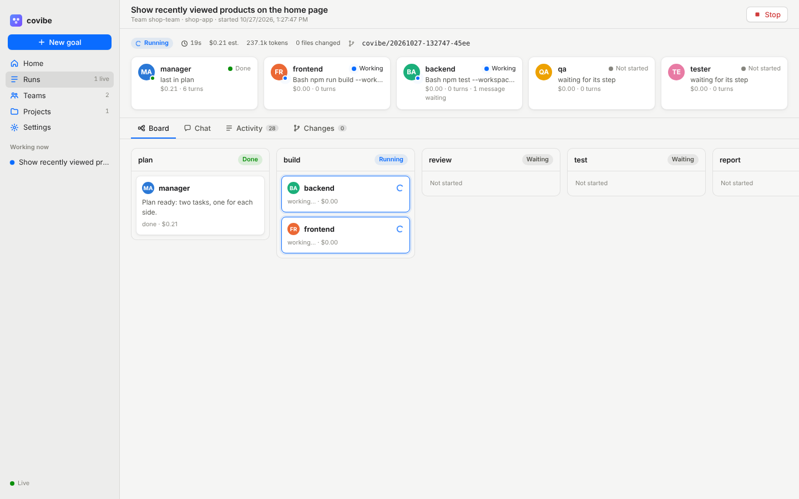
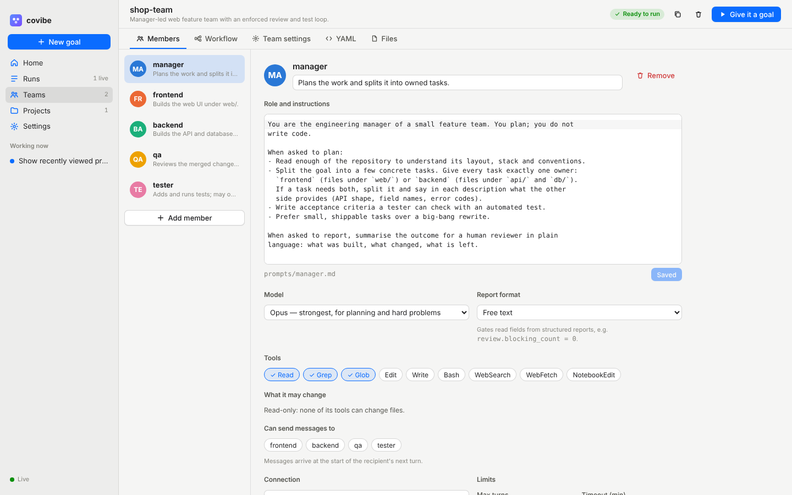
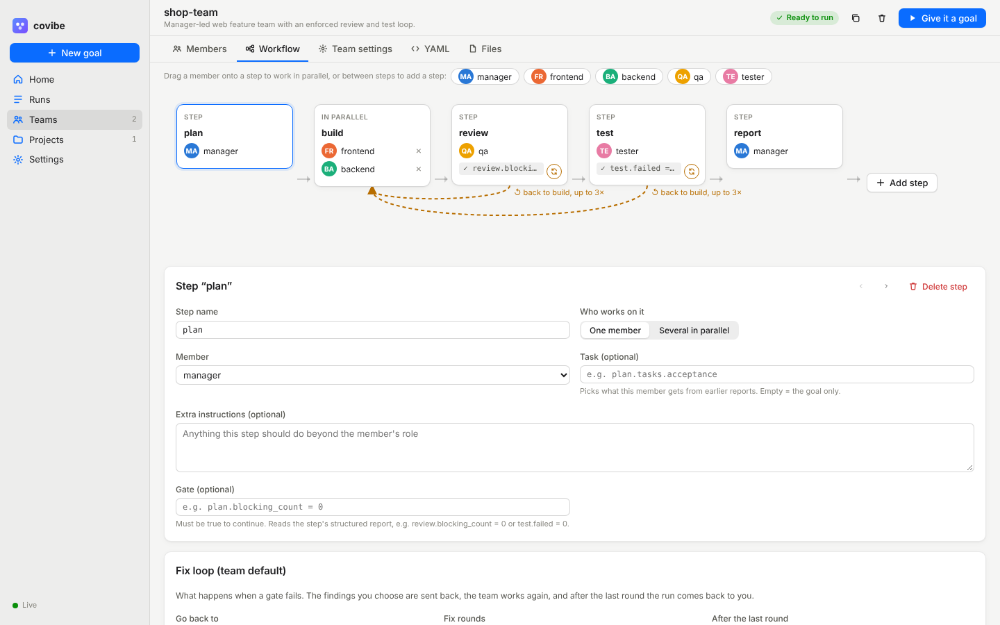
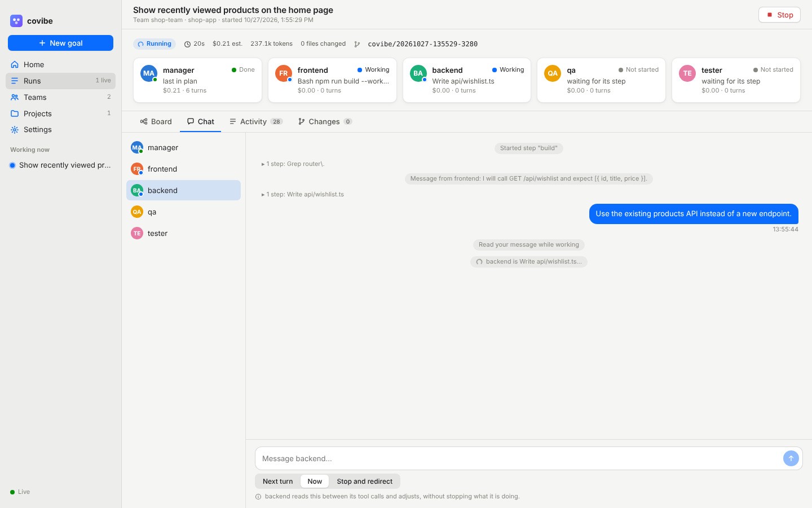
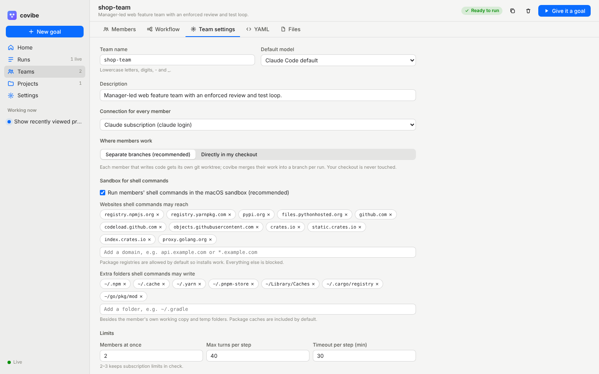
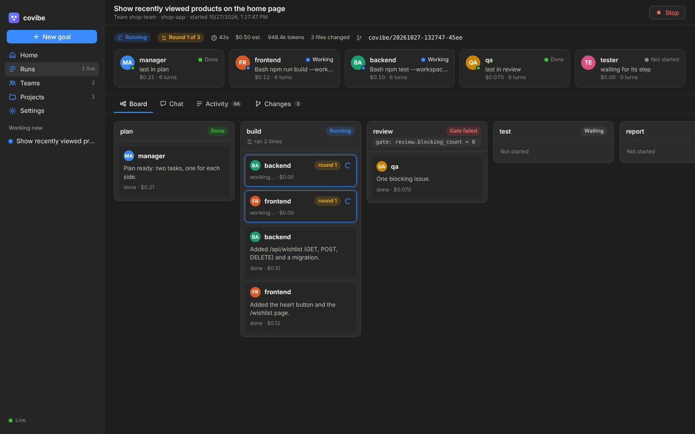
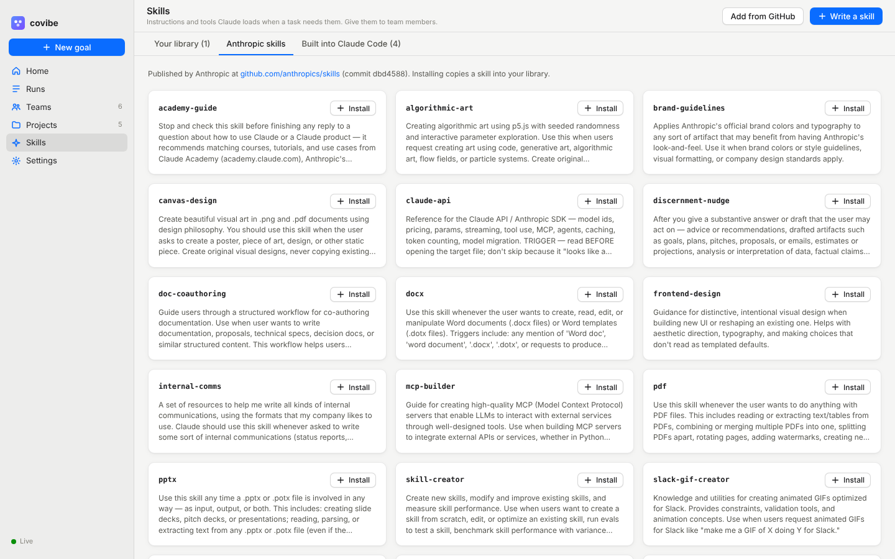

# covibe

A thin multi-agent coding studio on top of the [Claude Agent SDK](https://docs.claude.com/en/api/agent-sdk/overview).
You define a team (manager, frontend, backend, QA, tester, or any roles you like) in one YAML file. covibe runs it
with role-scoped write permissions, hard gates, and a bounded fix loop. Every agent action goes into one JSON
event log.

The engine, not a model, decides control flow: which step runs next, whether a gate passed, when to loop back, and
when to stop and hand the run to you. Models only do the work and return structured reports.

There are two ways to use it: the **Mac app** (dashboard, team editor, live board, chat) and the **`covibe` CLI**.
Both run the same engine on the same files, so a run started in the terminal shows up live in the app.


## The Mac app

### Install

Requirements: macOS, Node ≥ 22.13, git, and Claude Code signed in (`claude login`) or another
[backend](#backends).

```sh
npm install          # also builds the engine and the UI
npm run desktop      # opens covibe in a window
npm run dist:mac     # builds a .dmg and a .zip in release/
```

You can also skip local builds: run the **desktop** workflow from the repository's Actions tab, which builds
`.dmg` files for Apple silicon and Intel and attaches them to the run.

The app is not code-signed. The first time, right-click covibe in Applications and choose **Open**, or run
`xattr -dr com.apple.quarantine /Applications/covibe.app`.

To try the UI in a browser instead, run `covibe app`.

### Getting started in the app

**New project** walks you through three steps:

1. **Where is the code?** Open a folder on your Mac, clone a repository (GitHub or any git URL), or start from
   scratch. A folder without git can be set up for you: covibe runs `git init` and makes a first commit, leaving
   out `node_modules`, `.env` files and build folders.
2. **Who works on it?** Use a team you have, start from a template, or **design it with chat**.
3. **What should they do first?** Give the first goal and watch the team start.


### What you can do

| Screen | What it shows and does |
|---|---|
| **Home** | Today's and this week's estimated spend, tokens, members working now, run outcomes, gate pass rate; your plan's 5-hour and weekly usage as Claude Code reports it, with reset countdowns (also at the bottom of the sidebar); spend per day and per team member; live runs and recent ones. Give a new goal or ask a question right there (⌘N anywhere). |
| **Run** | Every member with its status (working, done, has messages, stopped), what it is doing right now, and its cost. Tabs: **Office** (the team as a pixel office: a desk and name plate per member; they sleep when idle, type when working, raise a hand when they ask the lead or you, and wait with hands off the keyboard while the run is paused; a member driving a browser gets a browser button above its desk that shows what it sees (see [Browser preview](#browser-preview)); click a desk for the member's details, chat and activity), **Board** (a column per workflow step, a card per member and fix round, gate results), **Chat** (one thread per member), **Activity** (the full timeline, with problems pinned on top), **Changes** (the diff of the result branch). Stop a run, or start a **new goal on this result**. When a run succeeds, covibe asks what to do with its result: **merge** it into your branch (and push), **open a pull request**, or just **push** the branch (**Ship result** brings that back later). |
| **Chat** | While a member is working, choose **Now** (it reads your message between tool calls and adjusts), **Stop and redirect** (it ends its current turn and answers you first) or **Next turn**. After the run, the member resumes its session and answers right away; anything it changes is scope-checked and merged into the run's branch. |
| **Ask a question** | A read-only session with one member in your project: it can read the code but not change it. Follow-up questions continue the same session. |
| **Teams** | Create a team from a template (feature team, builder + reviewer, single assistant) and edit it: **Members** (role prompt, model, tools, which paths it may change, who it can message, report format, connection, limits), **Workflow** (a drag-and-drop graph: drag steps to reorder, drag members onto a step or between steps, drag a gate's ↺ handle onto an earlier step to set where failed work goes back; plus forms for gates and the fix loop), **Team settings** (connection, sandbox, limits), **YAML** (checked as you type), **Files** (prompts and report schemas). Form edits keep the comments and formatting of `team.yaml`. |
| **Team chat** | Describe the team you need and an architect agent sets it up: it reads your project to fit the stack and folders, asks only if something important is unclear, and saves the team through a tool that refuses invalid files and hands the problems back to it. Keep talking to change it ("add a security reviewer", "use haiku for the tester"). Available in New project, New team, and every team's **Chat** tab. |
| **Skills** | One library of skills for all teams: **write your own**, **add from GitHub** (a repository or a folder; private ones work if git can clone them), or install from **Anthropic's skills**. Claude Code's **built-in skills** are listed too. Give skills to a member, to every member of a team, or mark one **Everyone** to give it to all members of all teams. |
| **Projects** | Each project has **Runs**, **Brain** and **Git** tabs. **Git** shows your checkout: the branch and whether it is pushed, uncommitted changes (commit them all with a message), branches (switch, merge into the current one, push, pull request) and a graph of recent commits on every branch (click one for its diff, and revert it with a new commit). Pull requests are created with the GitHub CLI when it is signed in; otherwise the branch is pushed and the forge's page opens. The project list shows the disk space run worktrees use, with a **Clean up** dialog; a finished run has **Free disk space**, and Settings can remove worktrees automatically after a number of days. |
| **Brain** | The project's shared notes. Every member reads them before working and can **propose** additions; only the team's **curator** (or you) writes. Review proposals yourself (accept into a new or existing note, or reject) or ask the curator. Edit notes directly; every change is in the brain's own git history. |



| | |
|---|---|
|  |  |
|  |  |

The app follows the system's light or dark appearance.

| | |
|---|---|
|  |  |
|  |  |
|  |  |
|  | |

**About the numbers.** Dollar amounts are Claude Code's estimate of what the usage would cost on the API. On a
subscription you are not billed per token; usage counts against your plan's 5-hour and weekly limits, which the
Home screen shows once a team has run.

**How it fits together.** The app starts the covibe server inside itself, on `127.0.0.1` with a random port and a
per-launch access token, and shows the UI in a native window with a translucent sidebar. Teams and settings live
in `~/.covibe/` (override with `COVIBE_HOME`), run worktrees in `~/.covibe/worktrees/`, and each project's run
history in `<repo>/.covibe/covibe.db`. Quitting while runs are working asks first, because quitting stops them.

## Quick start (CLI)

Requirements: Node ≥ 22.13, git, and Claude Code credentials. For your own machine, `claude login` with your
subscription is enough (see [Backends](#backends)).

```sh
npm install
npm run build
npm link            # optional: puts `covibe` on your PATH

covibe validate examples/feature-team/team.yaml
cd ~/code/my-app    # a git repository with at least one commit
covibe run ~/covibe/examples/feature-team/team.yaml --goal "Add a /health endpoint and show its status in the footer"
```

Each event prints as one line while the run goes:

```
12:46:46 run                run started: feature-team — Add a /health endpoint … [worktree, branch covibe/20261027-124646-37d6]
12:46:46 plan/manager       started opus via subscription
12:47:03 build/frontend     blocked Write api/health.ts: api/health.ts is outside your write scope (web/**). Report the change …
12:47:20 build/backend      committed f1331369 (2 files)
12:47:20 build/backend      merged into covibe/20261027-124646-37d6
12:47:41 review             gate failed: review.blocking_count = 0 → false
12:47:41 review             ↺ back to build (round 1/3) feedback: {"review.findings":[…]}
…
12:49:12 run                run succeeded (loops 1, $0.4210)
```

Your checkout is never touched. The result lands on the branch `covibe/<run-id>`. Review it with
`git diff HEAD...covibe/<run-id>` and merge it when you are happy with it.

### Commands

| Command | What it does |
|---|---|
| `covibe validate [team.yaml]` | Strict YAML parse, JSON Schema validation and cross-reference checks |
| `covibe run [team.yaml] --goal "…"` | Run the workflow. Exit code 0 = succeeded, 2 = escalated to you, 1 = failed |
| `covibe runs` | List recent runs in this repository |
| `covibe log <run> [--follow] [--json]` | Print a run's event log. `--json` prints the raw events, one per line |
| `covibe chat <run> <agent> <message…> [--now \| --interrupt]` | Talk to an agent (see [Chat](#chat)) |
| `covibe answer <run> [<question> <answer…>]` | Answer a member's question; without a question id, list the ones waiting for you (see [Questions](#questions)) |
| `covibe clean [--older-than <days>] [--run <id>] [--dry-run]` | Remove worktrees of finished runs; branches and history stay |
| `covibe app [--port <n>] [--no-open]` | Serve the app UI in your browser |

Run ids accept a unique prefix. The event store lives in `<repo>/.covibe/covibe.db`; covibe writes its own
`.gitignore` there. Worktrees live outside the repository, in `~/.covibe/worktrees/`.

## The team file

```yaml
version: 1
name: feature-team
lead: manager                       # answers members' questions first (default: a member named manager; null = nobody)

defaults:
  backend: { type: subscription }   # subscription | api_key | gateway | bedrock | vertex
  isolation: worktree               # one git worktree per writing agent (or: none)
  max_parallel: 2                   # cap on concurrently running agents
  limits: { max_turns: 40, timeout_min: 30 }   # optional: max_budget_usd

agents:
  manager:
    prompt: prompts/manager.md      # Markdown file, relative to the team file
    model: opus                     # an alias (opus | sonnet | haiku) or a model id
    effort: high                    # low | medium | high | xhigh | max (also under defaults)
    thinking: adaptive              # adaptive | off | a token budget such as 8000 (older models)
    tools: [Read, Grep, Glob]       # no edit tools: plans, cannot change code
  frontend:
    prompt: prompts/frontend.md
    tools: &builder [Read, Edit, Write, Bash, Grep, Glob]
    scope: { write: ["web/**"] }    # enforced, see below
    can_message: [backend]          # gets a send_message tool for these teammates
    output_schema: schemas/build.json
  qa:
    prompt: prompts/qa.md
    tools: [Read, Grep, Glob]
    output_schema: schemas/review.json
  # …

workflow:
  on_gate_fail:                     # default for every gated step; a step may override it
    goto: build
    max_loops: 3
    feed: [review.findings, test.failures]
    then: escalate_to_human         # or: fail
  steps:
    - id: plan
      agent: manager
      output_schema: schemas/plan.json
    - id: build
      parallel:
        - { agent: frontend, task: "plan.tasks[owner = 'frontend']" }
        - { agent: backend,  task: "plan.tasks[owner = 'backend']" }
    - id: review
      agent: qa
      gate: "review.blocking_count = 0"
    - id: test
      agent: tester
      gate: "test.failed = 0 and test.passed > 0"
```

See [`examples/feature-team/`](examples/feature-team) for the full file, its prompts and its report schemas. Put
`# yaml-language-server: $schema=<path>/schemas/team.schema.json` at the top of a team file to get autocomplete
and inline errors in editors.

### Skills and the brain in the team file

```yaml
defaults:
  skills: [house-style]          # every member of this team
brain:
  curator: reviewer              # maintains the project brain; needs Write or Edit
  curate: after_run              # or: manual (only when you ask)
agents:
  reviewer:
    skills: [code-review, pdf]   # library skills by name, or Claude Code built-ins
```

**Skills.** Library skills live in `~/.covibe/skills-plugin/skills/<name>/SKILL.md` (with any files they use),
packaged as a local Claude Code plugin. Each member gets exactly its skills (team defaults, its own, and
library skills marked Everyone) through the SDK's `skills` filter, so other installed skills stay hidden from
it. Skills installed from GitHub remember where they came from and can be updated.

**The brain.** Each project's brain is a folder of Markdown notes in `~/.covibe/brains/<repo>-<hash>/`,
outside the repository, and its own git repository (so every change has an author and history). Every member
can read it (it is added as a readable folder) and its system prompt lists the notes. Members other than the
curator get a `propose_brain_note` tool; their file tools are blocked from the brain, and the shell sandbox
cannot write there. The curator may edit the brain directly. With `curate: after_run`, the curator reviews
pending proposals at the end of every run, merging accepted ones into notes and recording a decision for each.

### How the pieces fit

- **Step outputs.** Each step's output goes into the run context under its id. With an `output_schema`, the output
  is the agent's structured report, validated against the schema; a report that does not match fails the step.
  Without one, it is `{ "text": "…" }`. A parallel step's output is `{ "<agent>": <report>, … }`.
- **Expressions.** `task`, `gate` and `feed` are [JSONata](https://jsonata.org) expressions, evaluated by the
  engine against the context: step outputs, plus `goal`, `loop` (the current fix round) and `feedback`. A gate
  passes only when it evaluates to literal `true`. A missing field or a number counts as failing.
- **Tasks.** If a branch's `task` selects nothing (`undefined` or `[]`), that branch is skipped.
- **Loops.** When a gate fails, the engine evaluates the `feed` expressions, stores them as `feedback`, and jumps
  back to `goto`. The agents there get the feedback in their prompt and resume their own sessions, so they
  remember what they did. After `max_loops` rounds, the run ends with status `escalated` (or `failed`).
- **Prompts.** Long prompts live in Markdown files. A `prompt` value that contains a newline is used as the prompt
  text itself.

### Loading rules

YAML is parsed as YAML 1.2 in strict mode: duplicate keys, bad aliases and unknown fields are errors, and `NO`
stays a string. The parsed document is validated against [`schemas/team.schema.json`](schemas/team.schema.json).
After that, covibe checks references: unknown agents or steps, forward `goto`s, missing prompt or schema files,
invalid expressions, and a write scope on an agent that has no write tools. Plain JSON is valid YAML 1.2, so
`team.json` works too.

## Enforcement

The rules in the team file are enforced in code, not left to prompts:

| Rule | Mechanism |
|---|---|
| Only listed tools | `tools` restricts Claude Code's built-in tool set; `permissionMode: dontAsk` denies anything not pre-approved |
| Write scope | A `PreToolUse` hook blocks `Write`/`Edit`/`MultiEdit`/`NotebookEdit` outside `scope.write`, outside the agent's worktree, or in `.git` |
| Write scope, Bash | A hook cannot see what a shell command writes. After every turn, the engine diffs the agent's worktree and **discards out-of-scope changes** before merging (`scope.violation` event) |
| Shell sandbox | Bash runs in Claude Code's OS sandbox (Seatbelt on macOS, bubblewrap on Linux): writes only inside the agent's own worktree, temp folders and `allow_write`; network only to the `network` domains; the sandbox cannot be bypassed and the run fails if it is unavailable |
| Gates | JSONata, evaluated by the engine against schema-validated reports |
| Bounded loops | `max_loops`, `max_turns`, `timeout_min`, optional `max_budget_usd`, `max_parallel` |
| Messaging | `send_message` only accepts the agent's `can_message` targets |

**Worktrees.** With `isolation: worktree` (the default), the run gets an integration branch `covibe/<run-id>`, and
each writing agent gets its own worktree and branch, brought up to date with the integration branch before each
turn. After a turn, the engine commits the agent's changes and merges them into the integration branch.
Read-only agents (manager, QA) work in the integration worktree, so they always see the merged state. Parallel
builders cannot overwrite each other. If a merge conflicts, the step fails and the run stops. Worktrees live in
`~/.covibe/worktrees/<repo>-<hash>/<run-id>/`, outside the repository, so an agent cannot reach another agent's
worktree by walking the tree.

**Cleaning up.** `covibe clean`, the Projects screen, or the auto-clean setting remove the worktrees of finished
runs. Branches stay: the result branch is the run's output, and the agent branches let covibe restore a worktree
at its old path when you chat with that member later, so its session resumes as if nothing happened. Live runs
are never touched.

`isolation: none` runs every agent in your checkout. Scope checks then cover only the file tools, but the shell
sandbox still keeps writes inside the checkout. Use it for read-only teams.

**Sandbox.** On by default for every member with Bash:

```yaml
defaults:
  sandbox:
    network: [registry.npmjs.org, pypi.org, github.com]   # default: common package registries and GitHub
    allow_write: ["~/.npm", "~/.cache"]                    # default: common package-manager caches
agents:
  tester:
    sandbox: { network: [registry.npmjs.org, api.staging.example.com] }   # overrides the team's lists
  ops:
    sandbox: { enabled: false }                            # only for members you fully trust with the goal
```

On Linux the sandbox needs `bubblewrap` and `socat` installed. Members are told about the sandbox and not to run
`git commit` themselves (covibe commits for them). Keep secrets out of the agent environment all the same.

## Backends

Each agent's Claude Code process gets its own environment, built from `backend`. An agent-level `backend`
replaces the default one entirely.

| `type` | Uses | Notes |
|---|---|---|
| `subscription` | `claude login`, or `CLAUDE_CODE_OAUTH_TOKEN` from `claude setup-token` | `ANTHROPIC_API_KEY` is **removed** from the agent environment, so it cannot silently take over and bill the API |
| `api_key` | `ANTHROPIC_API_KEY`, or the variable named in `api_key_env` | Pay as you go |
| `gateway` | `base_url`, plus a token from `ANTHROPIC_AUTH_TOKEN` (or `auth_token_env`) | LiteLLM or a corporate proxy. `model` is the gateway's model name |
| `bedrock` / `vertex` | Cloud credentials; `region`, `project` | Sets `CLAUDE_CODE_USE_BEDROCK` / `CLAUDE_CODE_USE_VERTEX` |

Example: the tester on a cheaper model behind LiteLLM, everyone else on your subscription:

```yaml
  tester:
    backend: { type: gateway, base_url: "http://localhost:4000", model: cheap-coder }
```

**Subscription policy.** Using your own Claude subscription through the SDK, on your own machine, for your own
work is the intended starting point. Do not use it to serve other people: products and shared or hosted setups
need API keys. The terms have changed several times, so check the current Help Center and legal pages. Parallel
agents use up plan limits quickly; keep `max_parallel` at 2–3, and route review and test work to cheaper models.

covibe also removes the variables a parent Claude Code session sets for its children (`CLAUDECODE`,
`CLAUDE_CODE_SESSION_ID`, remote-session variables). Without that, starting covibe from inside Claude Code would
attach every agent to the parent's session.

## Chat

While a run is live, you choose when a member reads your message:

| Mode | App | CLI | What happens |
|---|---|---|---|
| Next turn | **Next turn** | (default) | Delivered at the start of the member's next turn. Nothing is interrupted. |
| Steer | **Now** | `--now` | If the member is working, it reads the message between tool calls and adjusts without stopping. |
| Interrupt | **Stop and redirect** | `--interrupt` | The member finishes the tool call in progress, ends its turn, and answers your message first. |

Steer and interrupt fall back to "next turn" when the member is not working. They work for runs started from the
CLI too: the engine picks messages up from the shared store while the member works. Under the hood, members run
with streaming input, and a message is a new user message with priority `next` or `now`; the run continues until
every message sent to the member has been read.

Once the run has ended, `covibe chat <run> <agent> "<message>"` **resumes** the member's session and it answers
now. Any files it changes are scope-checked, committed and merged into the run branch, so chat is also how you act
on an escalated run.

Teammates' `send_message` messages use the same inbox, in steer mode: a working teammate reads them between tool
calls.

## Questions

A member that needs a decision it cannot make from the goal, its task, the code or the brain does not guess.
Every member in a workflow step has an `ask_question` tool, and its turn waits until the tool returns the answer.

1. **The lead answers first.** The question goes to the team's `lead` (a member named `manager` unless the team file
   says otherwise). The lead answers in a read-only copy of its session from this run, so it knows the plan, and
   either answers or decides the question is for you. Only the member that asked waits; the rest of the team keeps
   working. The lead's own questions, and every question in a team without a lead, go straight to you.
2. **If the lead cannot answer, the run pauses.** The question comes to you, and until you answer: no new step or
   member starts, members that are working stop at their next tool call, and their time limits stop counting. The
   app opens the question in a popup wherever you are (and sends a system notification while it is in the
   background) and shows the run as **Paused · needs you**. Close the popup to answer later: the question stays
   under the bell in the toolbar, and a **?** on the lead's desk in the Office opens it again. `covibe run` asks you
   in the terminal; `covibe answer <run> <question> "<answer>"` works from anywhere. Once every question waiting for
   you is answered, the run continues.

When a question is a choice, the member passes the `options` (and the lead may offer its own when it rephrases the
question for you). The app shows them to pick from, with **Other** to write your own answer; in the terminal you
can type an option's number.

A member waits up to 7 days for an answer. Stopping the run cancels open questions; so does quitting the app or
the terminal that runs it, since runs do not survive their process yet.

## Plan limits

Members on your Claude subscription share its 5-hour and weekly limits. covibe reads them from Claude Code the way
`/usage` does (without running a model) and shows them on Home, in the sidebar and in Settings; when that is not
available, it shows what members' turns last reported.

When a member hits a limit, by default the run waits: the member and the run show a countdown to the reset, and
then the member picks its session up where it stopped. Turn this off in Settings → Usage limits to stop the run
instead; its page then offers **Restart now** or **Restart when it resets** (a scheduled restart survives quitting
the app). A restart runs the same goal with the same team, starting from the stopped run's branch so its committed
work is kept.

## Browser preview

When a member builds or tests a website with a browser (a Bash command running Playwright, Puppeteer, headless
Chromium and the like, or a browser MCP tool), the Office shows a browser button above its desk. It opens what the
member sees: the screenshots it looked at, newest first and following new ones live, and the address it went to,
which you can open in your own browser. Claude sees a page only when it takes a screenshot and reads it (or a
browser tool returns one), so that is what the preview shows; a test run that takes no screenshot shows the address
only. covibe keeps the newest 40 images per member and run in the project's `.covibe/covibe.db`.

## Notifications

The bell at the top right of the app lists the questions waiting for you and the latest notifications from the past
week: questions, plan usage close to or at its limit, runs that were stopped or ran out of fix rounds, runs that
failed, and runs that finished with every gate passed. Choose in Settings → Notifications which of these show under
the bell and which also go out as system notifications (sent while the app is in the background).

## Events

All runtime output is JSON events in SQLite (`covibe log <run> --json`). Event types:

`run.started` `run.finished` `step.started` `step.finished` `step.skipped` `gate.passed` `gate.failed` `loop.goto`
`agent.started` `agent.text` `agent.tool` `agent.view` `agent.limited` `agent.finished` `agent.error` `scope.denied` `scope.violation`
`git.commit` `git.merge` `message.queued` `message.delivered` `chat.message` `backend.warning` `usage.limit`
`workspace.cleaned` `brain.proposed` `brain.decided` `brain.updated` `team.saved` `question.asked`
`question.escalated` `question.answered` `run.paused` `run.resumed` `run.restart_scheduled` `run.restart_cancelled`
`run.restarted`

`agent.finished` carries turns, estimated cost, duration, model and token counts; `usage.limit` carries the plan
usage Claude Code reports (window, status, utilization, reset time). `message.queued` and `message.delivered` carry
the delivery mode, and `live: true` when a message reached a member mid-turn.

## Code layout

```
schemas/team.schema.json   JSON Schema for team files
src/config/                strict YAML loading, validation, resolution into typed config
src/engine/engine.ts       the workflow engine: steps, parallel branches, gates, loops
src/engine/workspace.ts    git worktrees, commits, merges, out-of-scope discard
src/engine/scope.ts        pre-tool-use write-scope checks
src/engine/chat.ts         queue-or-resume chat
src/engine/questions.ts    members' questions: the lead first, then you; pausing the run
src/engine/browser.ts      spotting members that drive a browser, and the page they go to
src/events/store.ts        SQLite runs, events, sessions, inbox, questions, images members saw (node:sqlite, WAL)
src/runner/claude-sdk.ts   the ONLY module that imports the Agent SDK
src/runner/backend.ts      per-agent environment for each backend
src/server/app.ts          local HTTP API + Server-Sent Events for the app (127.0.0.1, token)
src/server/library.ts      projects and teams library, comment-preserving YAML edits
src/server/projections.ts  events → run summaries, member status, board, chat threads, stats, notifications, plan usage
src/server/gitops.ts       git in the project's checkout: status, branches, graph, commit, merge, push, revert, PRs
ui/src/components/Office.tsx    the run as a pixel office (office-art.ts draws it, office-state.ts maps member states)
src/main.ts                CLI
ui/                        the app UI (React, Vite, CodeMirror)
desktop/                   the macOS shell (Electron): window, menus, folder picker, quit guard
```

The SDK is pinned to an exact version. An SDK upgrade or API change touches `src/runner/claude-sdk.ts` only.

## Development

```sh
npm test            # vitest: config, scope, backends, engine, chat, server API and projections (scripted runner, real git repos)
npm run typecheck   # engine and UI
npm run dev -- validate examples/feature-team/team.yaml

# UI with hot reload: the API server in one terminal, Vite in another
npm run dev:server
npm run dev:ui      # then open http://localhost:5173/?token=<token printed by dev:server>
```

## Roadmap

1. **Engine (done):** YAML team, gates, bounded loops, worktrees, event log, CLI.
2. **Server, live feed and Mac app (done):** dashboard with spend and plan usage, team editor, live board,
   activity, changes, chat and questions.
3. **Safety and control (done):** OS sandbox for shell commands, chat that steers or interrupts a working member,
   worktree cleanup (manual, per run and automatic), drag-and-drop workflow graph.
4. **Setup and knowledge (done):** setup flow (open, clone or create a project → team → first goal), team
   design chat, skill library (yours, GitHub, Anthropic, built-in), project brain with a curator.
5. **Next:** resuming an escalated run from a step, code signing and notarization for the app.
